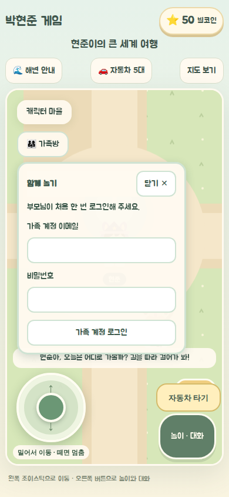
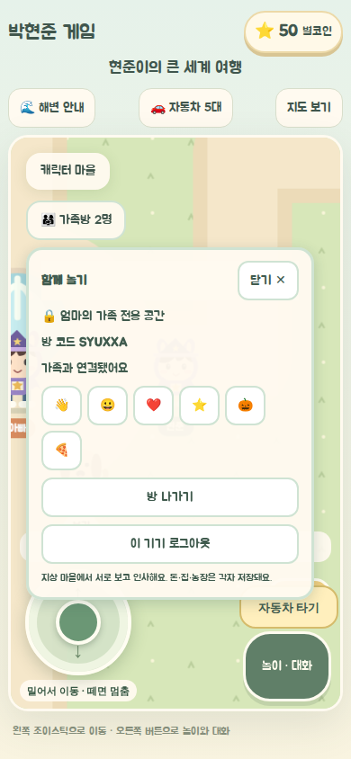
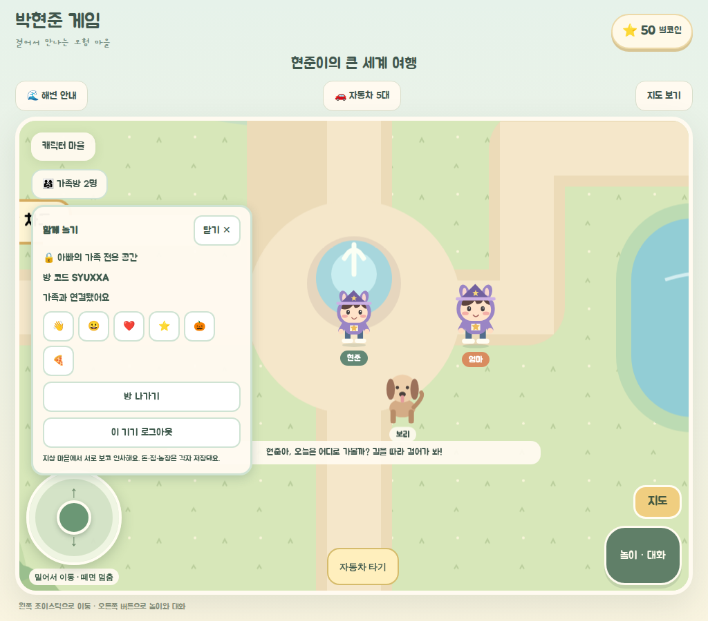

# Supabase 가족방 구현

사용자 승인: 2026-10-20, Supabase 추천안 진행. GitHub Pages 유지. 부모가 네 기기에 가족 계정으로 처음 한 번 로그인한다.

1. 가족 메시지의 좌표·의상 검증, heartbeat, 감정 표현 제한, 객체 키 안전성, 경계 보간을 수정한다.
2. private Broadcast로 이동을 보내고 Presence로 입퇴장을 처리한다. 늦은 입장과 재연결에는 현재 상태를 재전송한다. 장애 시 같은 기기 모드로 몰래 전환하지 않는다.
3. 가족 계정·구성원 확인과 로그인 UI를 제공한다. Supabase 설정이 전혀 없을 때만 명시적인 같은 기기 모드로 동작한다.
4. 가족 구성원 SQL/RLS와 GitHub Pages 공개 환경 변수, 연결 가이드를 작성한다. 게임 저장·재화는 기기에 유지한다.
5. 단위·타입·린트·빌드와 두 브라우저 화면/입력 테스트를 실행한다. 실제 프로젝트 키·계정·SQL 설정이 없으면 실서비스 연결은 미검증으로 구분한다.

1단계 공유 범위는 지상 월드의 캐릭터·인사뿐이다. 집·식당·잠수함·미니게임 입장 중에는 월드에서 숨는다. 돈·집·농장·차량 상태와 자유 채팅은 전송하지 않는다. 가족 구성원은 서로 다른 네 계정으로 관리하며, 네트워크의 동시 연결 수를 서버에서 엄격히 네 개로 제한한다고 주장하지 않는다.

계정·권한 설정은 사용자가 Supabase 대시보드에서 수행한다. 실제 비밀번호·비공개 키는 코드와 문서에 넣지 않는다. push·merge·배포는 포함하지 않는다.

## 구현·검증 결과

- `npm test`: 103개 통과. 실제 PostgreSQL 호환 런타임에서 마이그레이션 재실행, 본인 구성원 조회, 클라이언트 수정 거부, 가족 간 채널 차단, 미등록·익명 접근 거부를 확인했다.
- `npx tsc --noEmit`: 통과. `npm run lint`: 오류 0개, 기존 Fast Refresh 경고 8개.
- `npm run build:pages`: Supabase 설정 유무 모두 정적 빌드 통과.
- `scripts/verify-supabase-family.cjs`: 실제 Supabase SDK를 로컬 HTTP/WebSocket 계약 서버에 연결하고 독립 브라우저 컨텍스트 두 개로 검증했다. 늦은 입장, 정지 유지, 반복 인사, 재접속, 실내 숨김, 즉시 퇴장, 가족 격리, 미등록 계정 차단, 로그인 복원·로그아웃과 개인 코인 유지를 확인했다.
- 휴대폰 390×844, 태블릿 1024×900 스크린샷으로 로그인·연결 UI를 검증했다. 가족방 패널이 게임 조작 위에 표시되며 휴대폰에서도 로그아웃을 누를 수 있다.
- 설정 없는 같은 기기 모드의 늦은 입장·정지 유지·즉시 퇴장과 UUID API가 없는 환경을 확인했다. 기존 게임의 두 손가락 이동·행동, 펜 입력·취소와 가로 넘침 방지 검증도 통과했다.
- 최초 구현 시 실제 연결은 미검증이었다. 이후 실제 Supabase 프로젝트의 SQL·비공개 채널 설정과 네 계정을 등록하고, 배포된 Pages에서 두 브라우저의 로그인·이동·인사·정지 유지·퇴장을 검증했다. 서로 다른 실제 기기·인터넷 회선은 **미검증**이다. [연결 가이드](SUPABASE_SETUP.md)에 따라 프로젝트를 설정한 뒤 확인한다.

스크린샷은 **로컬 계약 서버의 테스트 계정**으로 촬영했다. 실제 운영 연결 증거가 아니다.

| 휴대폰 로그인                                     | 휴대폰 가족방                                         | 태블릿 가족방                                          |
| ------------------------------------------------- | ----------------------------------------------------- | ------------------------------------------------------ |
|  |  |  |

브라우저 검증 재현: `bun run scripts/family-supabase-fixture.ts`로 로컬 계약 서버를 시작하고, `VITE_SUPABASE_URL=http://127.0.0.1:4194 VITE_SUPABASE_PUBLISHABLE_KEY=sb_publishable_browser_contract npm run build:pages`로 테스트 빌드를 만든다. 4183 포트에서 미리보기를 실행한 뒤 `PLAYWRIGHT_CORE_PATH`, `CHROMIUM_EXECUTABLE`을 설치된 브라우저 도구에 맞게 지정하고 `node scripts/verify-supabase-family.cjs`를 실행한다. 이 테스트용 URL·키로 운영 배포하지 않는다.

2026-10-20 로그인 입력을 가족 버튼 + 암호 하나로 줄였다. 암호 보기·숨기기, 가족 변경 시 암호 삭제, 실제 아빠·엄마 로그인과 비공개 방 연결을 휴대폰 화면에서 검증했다.
