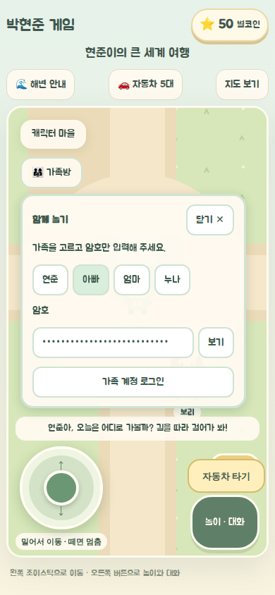
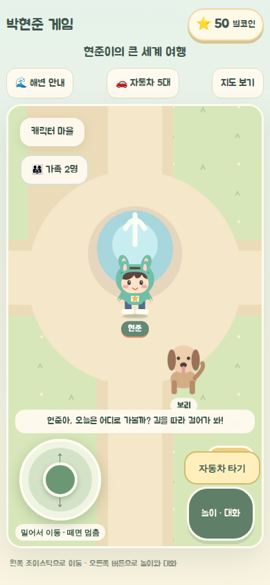

# 가족방 Supabase 연결 가이드

게임 주소와 호스팅은 GitHub Pages 그대로 사용한다. Supabase는 가족 로그인과 실시간 위치·인사만 담당한다. 돈·집·농장·차량 저장은 각 기기의 기존 저장에 남는다. Lovable이나 별도 Worker 서버는 필요 없다.

2026-10-20 게임 전용 프로젝트의 가족 계정·SQL·비공개 Realtime 설정을 적용하고, 배포된 Pages에서 실제 Supabase 로그인과 두 브라우저의 이동·인사·퇴장을 검증했다. 아래 절차는 프로젝트를 새로 설정할 때 참고한다. 서로 다른 실제 기기·인터넷 회선의 확인은 별도로 수행한다.

## 1. 무료 프로젝트 만들기

1. [Supabase Dashboard](https://supabase.com/dashboard)에 가입·로그인한다.
2. 새 프로젝트를 만든다. 기존 업무용 프로젝트와 분리된 게임 전용 프로젝트를 권장한다.
3. 프로젝트 이름과 데이터베이스 비밀번호를 정한다. **DB 비밀번호는 게임에 넣지 않는다.**
4. 프로젝트의 Connect 또는 Settings → API Keys에서 다음 두 값을 확인한다.

| 필요한 값                            | 용도                    |
| ------------------------------------ | ----------------------- |
| Project URL: `https://….supabase.co` | 게임이 접속할 공개 주소 |
| Publishable key: `sb_publishable_…`  | 브라우저용 공개 키      |

기존 프로젝트의 `anon` 키도 지원한다. `sb_secret_…`와 `service_role` 키는 사용하지 않는다. 키를 Secrets에 넣더라도 `VITE_` 변수는 최종 브라우저 파일에 포함되므로 비밀 키를 넣어서는 안 된다.

## 2. 가족 계정 네 개 만들기

1. Authentication → Users → Add user / Create user에서 아빠·엄마·누나·현준 계정을 각각 만든다.
2. 게임 전용 ID `dad@phj-game.invalid`(아빠), `mom@phj-game.invalid`(엄마), `sister@phj-game.invalid`(누나), `hyunjun@phj-game.invalid`(현준)를 사용하고 각자 다른 숫자 6자리 암호를 정한다. 실제 메일을 받지 않는 로그인용 ID이므로 이메일 확인이 완료된 계정으로 만든다. 관리자 생성의 Auto Confirm 옵션을 사용할 수 있다.
3. **각 계정의 User UID**를 복사해 둔다. 계정 이메일이나 비밀번호와는 다른 UUID다.
4. Authentication 설정에서 공개 신규 회원가입을 끈다. 이 게임에는 회원가입 화면이 없다.
5. URL Configuration의 Site URL은 실제 게임 주소, 예를 들어 `https://haapy-mind-life.github.io/phj-game/`로 설정한다.

아이에게 이메일 입력을 맡길 필요는 없다. 가족 버튼을 선택하고 암호만 입력한다. 부모가 각 기기에 한 번 로그인하면 해당 브라우저의 세션을 사용한다. 비밀번호는 코드·저장소·GitHub Variables·대화창에 넣지 않고 게임의 로그인 화면에만 입력한다. 게임을 닫았다 다시 열 때 세션이 유효하면 다시 로그인할 필요가 없다. 공용 기기는 사용 후 “이 기기 로그아웃”을 누른다.

## 3. 가족 전용 접근 권한 설정

1. SQL Editor에서 [가족방 SQL](../../supabase/migrations/202610200001_family_room.sql)을 열어 **내용 전체를 실행**한다. 이 SQL은 구성원 테이블과 비공개 실시간 채널 권한을 만든다. 게임 재화 테이블은 만들지 않는다.
2. 아래 예제의 네 `USER_UID_…`를 2단계에서 복사한 실제 UUID로 바꾸고 **한 번 실행**한다. 네 행에 같은 `family_id`가 자동으로 배정된다.

```sql
with family as (
  select gen_random_uuid() as id
)
insert into public.family_members (user_id, family_id, nickname)
select member.user_id::uuid, family.id, member.nickname
from family
cross join (values
  ('USER_UID_DAD', '아빠'),
  ('USER_UID_MOM', '엄마'),
  ('USER_UID_SISTER', '누나'),
  ('USER_UID_CHILD', '현준')
) as member(user_id, nickname);
```

3. Table Editor의 `family_members`에서 네 행의 `family_id`가 같고 이름이 올바른지 확인한다. 가족 구성원은 관리자만 등록·수정할 수 있다.
4. Realtime 설정에서 **Allow public access를 끄고 private 채널만 허용**한다. 필요한 Broadcast와 Presence는 켠다.
5. 새 프로젝트가 아니라면 `realtime.messages`에 다른 광범위한 허용 정책이 남아 있지 않은지 확인한다. 이 게임이 추가하는 정책 이름은 `family_receives_private`, `family_sends_private`다.

다른 가족의 프로젝트 구성원을 추가할 때는 별도의 `family_id`를 사용한다. 로그인하면 가족 ID에 해당하는 비공개 공간에 자동 접속한다. 가족 ID가 다르면 서로 만나지 않는다. 계정을 Authentication에 만들기만 하고 구성원 행을 등록하지 않으면 게임은 접속을 허용하지 않는다.

구성원은 네 이름으로 제한되지만 **서버가 WebSocket 연결을 정확히 네 개로 제한하는 구조는 아니다.** 가족당 네 기기, 기기당 게임 창 하나로 사용한다. 화면의 접속 인원 확인은 편의 기능이다. 닉네임은 구성원 정보에서 표시하며 금전·게임 권한을 부여하는 관리자 역할이 아니다.

## 4. 게임에 공개 설정 넣기

### 내 PC에서 먼저 확인

저장소의 `.env.example`을 참고해 `.env.local`을 만들고 실제 공개 값 두 개를 넣는다. `.env.local`은 커밋하지 않는다.

```dotenv
VITE_SUPABASE_URL=https://YOUR_PROJECT.supabase.co
VITE_SUPABASE_PUBLISHABLE_KEY=sb_publishable_YOUR_PUBLIC_KEY
```

```bash
bun install --frozen-lockfile
npm run build:pages
npm run preview:pages -- --host 127.0.0.1 --port 4183
```

브라우저에서 `http://127.0.0.1:4183/phj-game/`를 연다. 환경 변수를 바꾸면 다시 빌드해야 한다. 개발 서버를 쓰는 경우에도 서버를 다시 시작한다.

두 값이 모두 없으면 화면에 **같은 기기 연습 모드**라고 나온다. 한 값만 있거나 비밀 키를 넣으면 설정 오류를 표시한다. 온라인 연결이 실패했다고 조용히 연습 모드로 바꾸지는 않는다.

휴대폰에서는 가족 버튼을 고르고 **숫자 암호 6자리만 입력**한다. 숫자 키패드를 사용하며 한 번 선택한 가족은 해당 기기에서 기억한다. 암호는 별도로 저장하지 않고 유효한 로그인 세션을 유지한다. “보기”로 입력 내용을 확인할 수 있으며, 가족을 바꾸면 입력한 암호를 지운다.



### GitHub Pages 설정

1. 저장소 Settings → Secrets and variables → Actions → **Variables**를 연다.
2. 다음 Repository variables 두 개를 등록한다.
   - `VITE_SUPABASE_URL`
   - `VITE_SUPABASE_PUBLISHABLE_KEY`
3. Supabase 연결 코드가 포함된 버전이 승인·반영된 뒤 기존 Pages 워크플로로 다시 빌드·배포한다. 공개 변수만 추가했을 때도 재배포해야 한다.

이 가이드나 구현 과정에서 자동 push·merge·Supabase SQL 실행·운영 배포를 수행하지 않는다. Supabase 프로젝트를 제어하는 개인 토큰도 필요 없다.

## CLI로 SQL 적용하기

연결 대상 프로젝트는 `eoyqdxmesfolifgjuetf`다. CLI가 별도로 설치되지 않았다면 다음처럼 실행할 수 있다.

```bash
npx supabase login
# 이 저장소에는 supabase/config.toml이 이미 있어 init은 다시 하지 않는다.
npx supabase link --project-ref eoyqdxmesfolifgjuetf
npx supabase db push --dry-run
npx supabase db push
```

CLI 로그인은 공개 publishable 키와 다른 관리자 인증이다. 브라우저 로그인 후 프로젝트를 연결하며, 필요하면 DB 비밀번호를 로컬 터미널 프롬프트에 입력한다. 제공된 연결 문자열의 `[YOUR-PASSWORD]`는 실제 비밀번호로 교체해야 하는 자리 표시자다. 비밀번호는 커밋하거나 대화창에 보내지 않는다. SQL 적용 후에도 2~3단계의 가족 계정 생성·구성원 등록과 Realtime 설정은 필요하다.

## 5. 실제로 가족 만나기

1. 각 기기에서 게임의 “가족 로그인”을 열고 가족 버튼과 숫자 암호 6자리로 로그인한다.
2. 로그인하면 가족 전용 공간에 자동 접속하고 로그인 패널이 닫혀 바로 게임을 한다. 방 만들기·방 코드 입력은 없다.
3. 다른 기기의 가족도 로그인만 하면 같은 공간에 들어온다. 가족 버튼의 접속 인원과 패널의 “가족과 연결됐어요” 표시를 확인한다.
4. 한 명이 가만히 있어도 사라지지 않는지, 늦게 로그인한 사람도 기존 가족을 보는지 확인한다.
5. 새로고침하거나 게임을 다시 열어도 유효한 로그인 세션으로 자동 접속한다. 연결이 잠시 끊기면 자동 복구한다. 게임을 종료하거나 “이 기기 로그아웃”을 누르면 다른 가족 화면에서 사라진다.
6. 집·식당·잠수함·미니게임에서는 월드 캐릭터가 숨고, 지상으로 돌아오면 다시 보인다. 실내·차량 외형과 게임 목표는 아직 공동 진행하지 않는다.
7. Wi-Fi와 휴대폰 LTE/5G처럼 서로 다른 네트워크에서도 확인한다. 비행기 모드를 켰다 끄고 재연결 표시와 복귀도 확인한다.

가입하지 않은 계정, 구성원으로 등록되지 않은 계정, 로그아웃 상태에서는 가족 공간에 들어갈 수 없어야 한다. Presence는 입퇴장에만 사용하고 이동은 Broadcast로 보낸다. 정지 상태는 2초 heartbeat로 유지하며 모든 일반 상태·인사 전송은 초당 최대 5회로 제한한다. 입장·재연결의 초기 상태 전달은 별도로 발생한다.



## 6. 연결이 안 될 때

| 화면·현상                  | 확인할 것                                               |
| -------------------------- | ------------------------------------------------------- |
| 같은 기기 연습 모드        | 두 공개 변수가 빌드에 전달됐는지, 재배포했는지          |
| 선택한 가족·암호 확인      | 관리자 생성 계정, 이메일 확인 여부, 올바른 암호         |
| 부모님이 가족으로 등록     | 로그인 계정 UID가 `family_members.user_id`와 일치하는지 |
| 가족 정보 확인 실패        | SQL 실행 여부, 프로젝트가 일시정지됐는지                |
| 로그인되지만 방 연결 실패  | Realtime private 설정, 두 정책, 유효한 세션             |
| 로그인했는데 안 만남       | 네 구성원의 `family_id`, 같은 마을·지상 화면인지        |
| 방이 가득 참               | 중복 창을 닫고 잠시 기다린 후 다시 연결                 |
| 위치는 되지만 집·돈이 다름 | 정상 동작. 이 단계는 개인 저장을 유지함                 |

무료 플랜은 1주 미사용 시 프로젝트가 일시정지될 수 있다. Dashboard에서 재개해야 한다. 무료 Realtime 메시지는 월 200만 건이며 송신·수신을 함께 센다. 네 명이 모두 초당 5번 계속 움직이면 하루 30분·30일 기준 약 432만 건에 입퇴장 메시지가 추가된다. 무료를 보장하지 않으므로 Dashboard의 사용량을 확인한다. Pro는 월 $25부터이며 한도·가격은 가입 시 공식 페이지를 다시 확인한다.

- [공개 키와 비밀 키](https://supabase.com/docs/guides/getting-started/api-keys)
- [비공개 Broadcast·Presence 권한](https://supabase.com/docs/guides/realtime/authorization)
- [Presence](https://supabase.com/docs/guides/realtime/presence)
- [요금](https://supabase.com/pricing)
- [메시지 사용량 계산](https://supabase.com/docs/guides/platform/manage-your-usage/realtime-messages)
