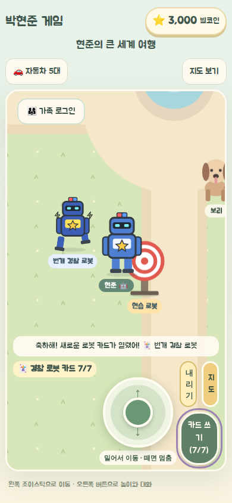
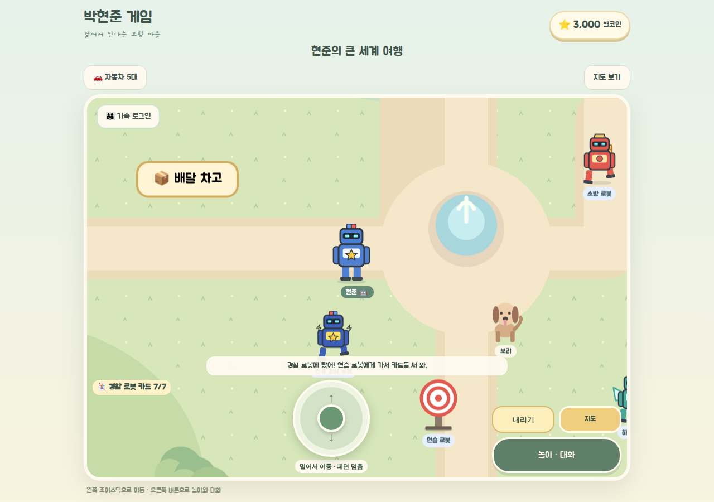

# 슈퍼 로봇 합체 월드 v1.0 — 작업 패키지

> 상태: **REQUEST + PROPOSED** · 2026-10-31 · 코드 변경 없음(문서만). 구현은 별도 승인 후 진행.

현준이가 구술한 "슈퍼 로봇 합체 월드"를 기존 박현준 마을에 더하는 계획이다. 기존 마을·집·식당·자동차·바다·러너는 그대로 두고, 마을에서 로봇을 만나 카드 → 전투 → 합체 → 강화로 이어지는 놀이를 추가한다.

| 문서 | 내용 | 상태 |
|---|---|---|
| [01_REQUIREMENTS_ORIGINAL.md](01_REQUIREMENTS_ORIGINAL.md) | 보호자가 정리한 현준이 구술 요구사항 원문 | REQUEST |
| [02_REVIEW_AND_SUPPLEMENT.md](02_REVIEW_AND_SUPPLEMENT.md) | 기획 검토: 현준이에게 물어볼 것, 모순·위험과 보완, RB 요구사항 ID와 수락 기준, 합체 진행표, 5분 놀이 시나리오 | PROPOSED |
| [03_ENGINEERING_PLAN.md](03_ENGINEERING_PLAN.md) | 구현 설계: 모듈 구조, 저장 형식 위험, 데이터 타입, PR 나누기, 검증 계획 | PROPOSED |

## 다음 단계

1. 현준이에게 [02 §2](02_REVIEW_AND_SUPPLEMENT.md#2-현준이에게-물어볼-것-unknown)의 질문(특히 RBQ-01 카드 7번 세는 법, RBQ-03 로봇에 타는지, RBQ-06 7번 다 쓰면 무엇이 열리는지)을 확인한다. 답이 없으면 임시안으로 진행한다.
2. 1차 PR-A(저장 준비 + 로봇 만나기·타기 + 카드 7회)부터 구현한다.
3. 1차 완료는 5분 놀이 시나리오가 메뉴 없이 월드 안에서 이어지는 것을 헤드리스 스크린샷으로 확인했을 때다.

## 구현 기록

### PR-A — 로봇 만나기·타기·카드 7회 (2026-11-01)

현준이 답을 받기 전이라 [02 §2](02_REVIEW_AND_SUPPLEMENT.md#2-현준이에게-물어볼-것-unknown)의 **임시안**으로 만들었다.

- 출발점 근처 마을에 경찰·소방·하늘 로봇 3종이 천천히 돌아다닌다. 바이저와 램프 눈의 기계 얼굴이다(사람 얼굴 아님). 화면 이름은 설명형(경찰 로봇 등)이고, 현준이가 지은 이름(메탈 폴리스 등)은 `src/game/robot-catalog.ts`의 `workName`에 보존했다.
- 가까이 가면 `<로봇> 만나기` → 카드를 받는다. 다시 누르면 `<로봇> 타기` → 조이스틱으로 로봇을 직접 움직인다. 왼쪽 버튼 `내리기`로 내린다. 차·비행기·잠수함·건물 안·지도 이동 때는 자동으로 내린다.
- 로봇을 탄 채 연습 로봇 가까이에서 `카드 쓰기 (n/7)`. 7번째에 "축하해! 새로운 로봇 카드가 열렸어!"와 함께 다음 로봇 카드(번개 경찰 로봇·화산 소방 로봇·레이저 하늘 로봇)가 열리고, 그 로봇도 마을에 나타나 탈 수 있다. 카드는 없어지지 않고 횟수는 저장된다.
- 로봇·카드는 각 기기에만 저장된다(가족방으로 보내지 않음).
- 남은 것(PR-B): 악당 로봇과 전투, 2·3단 합체, 재료와 강화.
- 검증 (2026-11-01):
  - 단위 테스트 131/131 PASS(로봇 6개 포함: 7회 해금 한 번만, 만나기 전 카드 사용 불가, 저장 정리, 기존 저장의 자동차·업그레이드·별코인 왕복 보존). `tsc --noEmit`·eslint PASS.
  - `scripts/verify-robot-world.cjs` (headless Chromium, 1280×900·390×844): 만나기·타기, 휴대폰 조이스틱 끌기로 로봇 이동, 카드 7회 → 축하 문구, 새로고침 후 7/7 유지·새 로봇 등장, 내리기, 탄 채 지도 이동 시 내려짐, 브라우저 오류 0건 PASS.
  - 기존 검사(RB-11): `verify-building-interiors.cjs`(빠른 실행), `verify-child-play.cjs`, `verify-living-world.cjs` PASS.
  - 실기기(삼성 브라우저·S Pen)와 현준이 직접 플레이는 NOT RUN.

