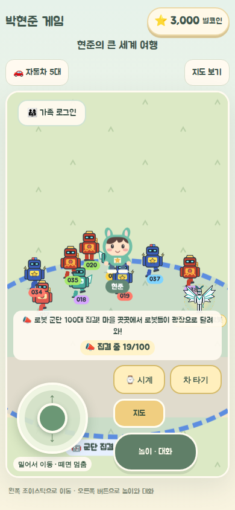
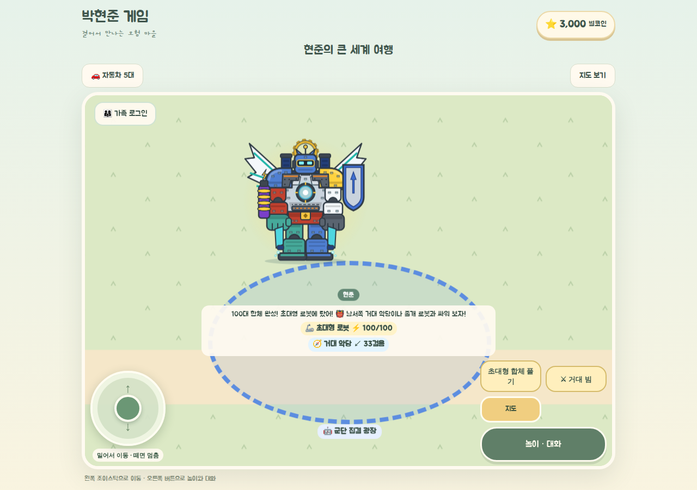
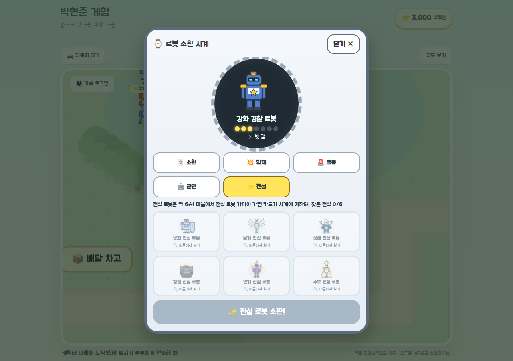
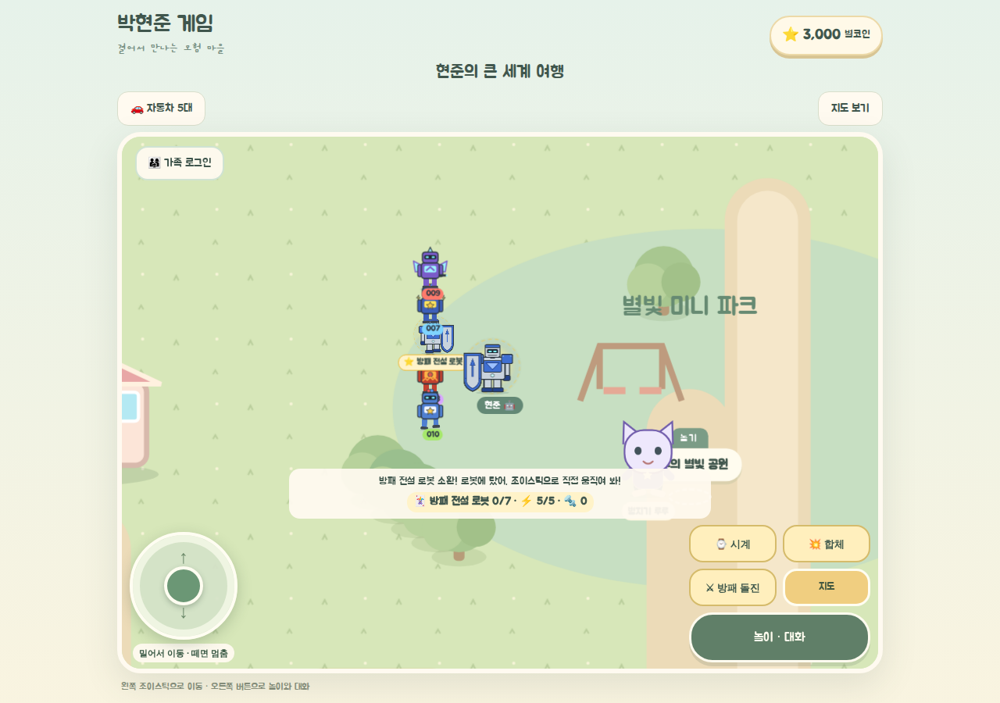
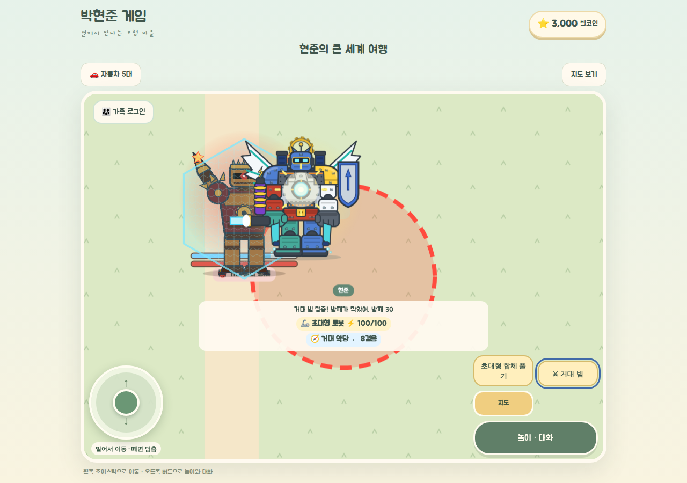
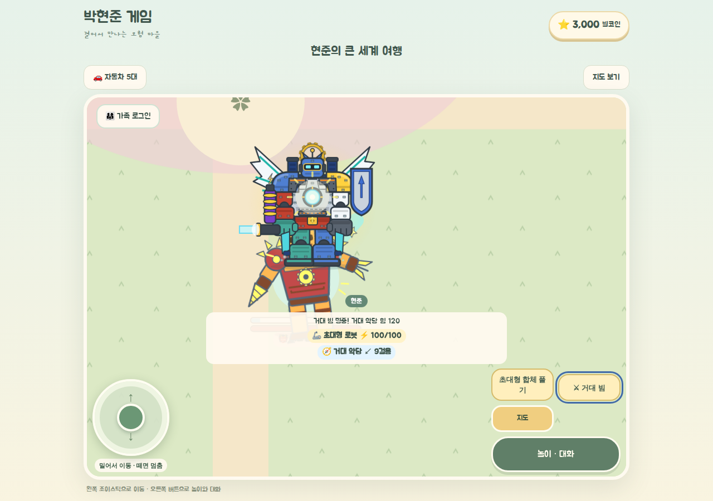
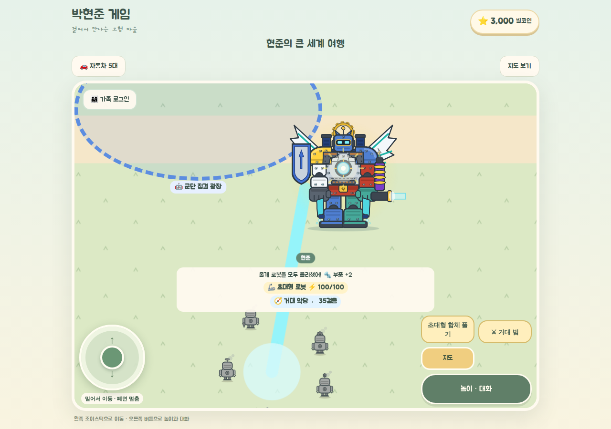
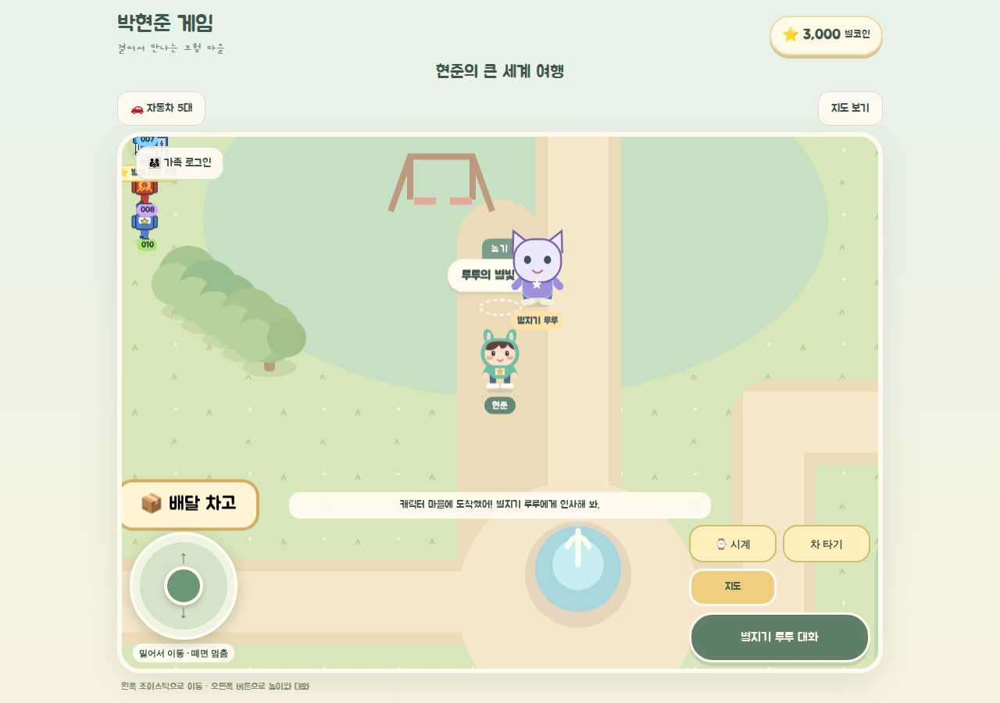
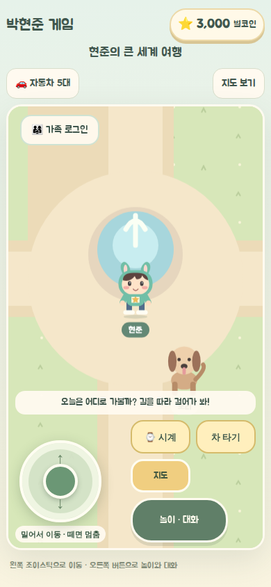

# 로봇 군단 100대 · 전설 6종 · 100대 합체 — 2026-11-01 (요구사항 v3)

> 표기: **REQUEST**(현준이·보호자 요구) / **FACT**(코드·실행 기록) / **PROPOSED**(임시안) / **UNKNOWN** / **NOT_RUN**.
> 브랜치 `feat/robot-army-100-legends-20261101`, 기준 `main` = `54a9a17`. `main` 병합은 보호자 승인 대기.

| 문서 | 내용 |
|---|---|
| [01_NEW_REQUEST_DELTA_V3.md](01_NEW_REQUEST_DELTA_V3.md) | 현준이 v3 구술 정리 원문 (REQUEST, RAQ 질문) |
| [02_CONSOLIDATED_REQUIREMENTS_V3.md](02_CONSOLIDATED_REQUIREMENTS_V3.md) | v1·v2·v3 통합 요구사항 원문 |
| [04_ACCEPTANCE_UAT_MATRIX.md](04_ACCEPTANCE_UAT_MATRIX.md) | 수락 기준 RA-AT-01~24 원문 |
| 이 문서 | 결정, 구현 내용, 검사 결과, 남은 일 |

## 1. 결론

**PARTIAL.** 게임 안에서는 다섯 가지가 모두 실제로 동작하고, 휴대폰(390×844)·태블릿(1280×900) 헤드리스 브라우저 자동 조작으로 확인했다.
- 로봇 100대가 월드에서 움직인다.
- 전설 로봇 6종을 마을에서 찾아 소환할 수 있다.
- 100대가 광장으로 실제로 걸어와 모이면 한 몸 초대형 로봇이 된다.
- 거대 악당과 졸개 로봇을 직접 움직여 싸운다.
- 저장이 유지된다.

PARTIAL인 이유는 삼성 브라우저·S Pen 실기기와 현준이 직접 플레이가 NOT_RUN이고, 아래 UNKNOWN 질문의 답을 아직 받지 못했기 때문이다.

## 2. 결정 장부

| 항목 | 판정 |
|---|---|
| 로봇 100대 = 월드 전체의 서로 다른 개체 100대 (RAQ-02) | PROPOSED, 그대로 구현 |
| 전설 = 새 6종, 기존 6종과 별개 | REQUEST, 구현 |
| 전설 6종은 100대 안에 포함 (각 부대 대장 6대) (RAQ-03) | PROPOSED. `LEGEND_SQUADS` 상수로 바꿀 수 있음 |
| 100대 합체 거대 로봇은 **아군**, 별도 거대 악당과 싸움 (RAQ-01) | PROPOSED. 합체 엔진은 진영과 분리되어 있어 적 군단 합체로도 바꿀 수 있음 |
| 집결은 🤖 군단 집결 광장에서만 부를 수 있음 (RAQ-05) | PROPOSED |
| 졸개 로봇 = 쉬운 악당 로봇 (RAQ-04) | PROPOSED |
| 전설 이름 (방패·날개·심해·강철·번개·수호 전설 로봇) (RAQ-06) | 작업명. 현준이가 정하기 전 확정 아님 |
| 전설 해금 = 마을에서 그 전설 로봇에게 가까이 가면 발견 | PROPOSED (확률·유료 뽑기 없음) |
| 거대 로봇의 공격은 카드 7회 사용에 세지 않음 | PROPOSED (거대 로봇은 카드가 아님) |
| 작은 로봇은 거대 악당에게 거의 피해를 못 줌 (방패만 조금) | PROPOSED |
| 균형: 경고 2초, 내려치기 20, 거대 로봇 체력 100, 거대 빔 10, 악당 방패 40·체력 120 | PROPOSED, 실기기 놀이 후 조정 |
| 기존 2·3단 합체 상한 `MAX_FUSION = 3` | 그대로 (100대 합체는 별도 엔진) |
| 저장 `version: 3`, 키 `hyunjun-game-v2` | 그대로 |

## 3. 구현 (M0~M5)

- **M0 기준선:** `main@54a9a17`에서 `npm test` 137/137, `tsc`, `lint` 오류 0, `build`, `build:pages` 모두 PASS.
- **M1 군단 100대** `src/game/robot-army.ts`
  - 고유 `instanceId` 100개(`army-001`~`army-100`), 20개 부대 × 5대. 부대는 30개 마을 중 20곳 근처에 있다(시작 근처 6곳 포함).
  - **순찰 부대**는 네모 길을 줄지어 돈다. **행진 부대**는 옆으로 나란히 서서 오간다.
  - 위치는 시간의 순수 함수다. 그래서 저장하지 않고, 지도 이동이나 새로고침 뒤에도 같은 자리에 있다.
  - 모든 로봇이 하루 종일 걸을 수 있는 땅에 있고, 문·놀이 장소·임무 장소를 피하며, 순간이동하지 않는 것을 단위 테스트로 막았다.
  - 화면에는 가까운 로봇만 그린다(최대 10대). 나머지는 보이지 않을 뿐 계속 움직인다.
- **M2 전설 6종** `robot-catalog.ts` `LEGENDS`, `LegendaryRobotArt.tsx`
  - 실루엣이 서로 다른 6종: 방패(큰 방패), 날개(큰 날개), 심해(돔 헬멧·프로펠러), 강철(무한궤도), 번개(번개 볏), 수호(톱니 후광·망토).
  - 각자 고유 무기·역할과 거대 합체 부품이 있다.
  - 시계에 "⭐ 전설" 탭이 생겼다. 발견하면 소환하고 탈 수 있고, 7회 성장과 2·3단 합체에도 참여한다.
- **M3 100대 집결·초대형 합체** `robot-mass-fusion.ts`, `GiantArt.tsx`
  - 광장에서 "📣 100대 집결!"을 누르면, 각 로봇이 실제 거리만큼 걸어온다(최대 약 15초).
  - 서로 다른 100대가 모두 도착해야 하고, 플레이어도 광장에 있어야 조립이 시작된다. 99대이거나 중복·가짜 id이면 안 된다.
  - 12개 부분이 날아와 붙어 한 몸 초대형 로봇이 되고, 전설 6종 부품도 붙는다. 작은 로봇은 시계로 돌아가고, 아이는 초대형 로봇을 타고 움직인다.
  - "초대형 합체 풀기"를 누르면 그 자리에서 100대로 흩어져 각자 집으로 걸어간다.
  - 집결 중에 지도로 떠나거나 건물·차에 들어가면 집결이 취소되고, 지금 있는 곳에서 집으로 돌아간다.
- **M4 전투** `robot-giant-battle.ts`
  - **거대 악당 "거대 톱니 황제"** (경기장 1000,3550)
    - 경기장 안에서 거대 로봇에게 걸어오다가, 빨간 경고 원을 2초 보여 주고 내려친다. 원 밖으로 피하면 맞지 않는다.
    - 방패가 먼저 막고, 방패가 깨지면 크게 맞을 때 휘청인다. 체력이 0이 되면 수리하러 후퇴하고 20초 뒤 돌아온다.
    - 내려치기 사이에는 반드시 걸어 다니는 시간이 있어서, 그동안 반격할 수 있다.
  - **졸개 로봇 5마리** (2700,3500): 거대 빔 한 번에 하나씩 고장 나 도망간다. 다 물리치면 10초 뒤 새 무리가 온다.
  - 모든 판정은 사거리·충전 시간 판정 함수(`resolveStrike`) 하나로 한다. 보상(100대 합체 횟수, 거대 악당, 졸개 무리)은 한 번만 지급한다.
  - 거대 로봇 체력이 0이 되면 안전하게 흩어질 뿐 잃는 것은 없다.
- **M5 검증**
  - 단위 테스트, 새 브라우저 검사 `scripts/verify-robot-army.cjs`, 기존 회귀 검사.
  - Codex 독립 리뷰(문제 4건 수정), 성능 측정.

## 4. 수락 테스트 (RA-AT)

증거: `scripts/verify-robot-army.cjs` 실행 로그와 `images/`. 화면에 그려진 로봇 위치를 엔진의 `armyPosition()` 계산값과 비교하고, 상태값(`data-*`)과 저장 데이터까지 확인했다.

| ID | 상태 | 확인한 사실 |
|---|---|---|
| RA-AT-01 | PASS | 엔진 등록부 100대, 고유 id 100 (`data-army-total`, `data-army-unique`) |
| RA-AT-02 | PASS | 서로 다른 마을 3곳(휴대폰 2곳)에서 로봇을 봤다. 화면 위치가 엔진 경로 계산과 40 이내로 일치 |
| RA-AT-03 | PASS | 3초 사이에 마을마다 3대 이상이 스스로 30 넘게 움직였다. 순찰·행진 두 가지 동작. 걸을 수 있는 땅·순간이동 없음은 단위 테스트 |
| RA-AT-04 | PASS | 집결하면 로봇들이 `rally` → `arrived` 상태로 광장에 모인다(대형 이동) |
| RA-AT-05 | PASS | 다른 마을에 갔다가 돌아와도 같은 id가 경로대로 다시 보인다 |
| RA-AT-06 | PASS | 시계 "⭐ 전설" 그룹에 6장, 그림 6가지가 서로 다름. 기존 소환 그룹 6장은 그대로 |
| RA-AT-07 | PASS (태블릿) | 전설 로봇에게 걸어가면 "전설 로봇 발견" → 카드 저장 → 소환하면 탄 상태로 전설 그림이 나온다 |
| RA-AT-08 | PASS | 기존 `verify-robot-world.cjs` AT-10 (7번째 사용에 강화, 한 번만, 새로고침 유지) |
| RA-AT-09 | PASS | 기존 `verify-robot-world.cjs` AT-05~07 (2·3단 한 몸 합체·분리) |
| RA-AT-10 | PASS | 집결 참가자 100(서로 다름), 도착 수가 실제로 늘어남 (예: 0→19→85→95→100) |
| RA-AT-11 | PASS (단위) | 99/100 미완성, 중복·가짜 id 거부. 브라우저에서 이 반례를 강제로 만드는 검사는 NOT_RUN |
| RA-AT-12 | PASS (태블릿) | 집결 중 광장을 떠났다 돌아와도 계속 진행. 지도로 떠나면 취소되고 보상 없음 |
| RA-AT-13 | PASS | 100/100 뒤 한 몸 거대 로봇(부분 12개, 전설 부품 6개). 작은 로봇은 시계로 돌아감. 100대 합체 1번 저장 |
| RA-AT-14 | PASS | 풀기 → 그 자리에서 흩어져 집으로 걸어감 → 새로고침해도 로봇 진행도·카드·별코인·자동차 그대로. 거대 로봇 중 새로고침하면 군단으로 돌아가는 것은 의도한 동작 |
| RA-AT-15 | PASS (태블릿) | 거대 악당이 경기장 좌표에 있고, 걸어오기·경고·내려치기·휘청임 상태가 바뀐다. 멀리서 쏘면 "너무 멀어"이고 변화 없음 |
| RA-AT-16 | PASS (태블릿) | 경고 원을 피하면 체력이 그대로. 실제 명중으로 방패 → 체력 0 → 후퇴, 거대 악당 1번 저장 |
| RA-AT-17 | PASS | 졸개 5마리를 실제 명중으로 하나씩 물리침, 졸개 무리 1번 저장 |
| RA-AT-18 | PASS | 새로고침·반복 정산에서 보상 중복 없음(단위 + 브라우저) |
| RA-AT-19 | PASS (헤드리스) | 휴대폰: 시계 탭 5개·주요 버튼이 화면 안, 높이 44px 이상, 입력창 0개 |
| RA-AT-20 | PASS (헤드리스) | 태블릿 1280×900 같은 확인. 가로·세로 회전은 NOT_RUN |
| RA-AT-21 | PARTIAL | 프레임 p95와 DOM 수는 아래 표. 실기기 측정 NOT_RUN |
| RA-AT-22 | PASS | 회귀 검사(건물 실내, child-play, living-world, 기존 로봇) PASS, 저장 `version: 3` 유지. 가족방 성능 검사 NOT_RUN |
| RA-AT-23 | NOT_RUN | 삼성 브라우저·S Pen·현준이 직접 플레이 |
| RA-AT-24 | PASS (검토) | 모두 새로 만든 기계형 디자인(바이저·램프 눈). 악당은 가상의 "녹슨 톱니 제국". 고장·후퇴로만 끝나고, 결제·확률 뽑기·실제 나라 연결 없음 |

## 5. 성능 (RA-AT-21)

| 상황 | 프레임 p95 | 기타 |
|---|---|---|
| 휴대폰, 로봇이 광장으로 몰려오는 중 (화면 로봇 10대) | 16.7ms | 힙 약 10MB |
| 태블릿, 같은 상황, CPU 4배 느리게 | 33.4ms (약 30fps) | |
| 태블릿, 초대형 로봇 탑승 | 16.7ms | |
| 태블릿, 새로고침 뒤 걷기 | 16.8ms / 33.3ms (두 번 실행, 들쭉날쭉) | 원인 미확인, 실기기 측정 필요 |
| `verify-living-world` 성능 지점 | 19ms (군단 추가 전 17ms) | DOM 2,101 (전 973) |

- 처음 버전은 군단 시계(0.1초)가 마을 화면 전체를 다시 그려서 living-world p95가 82ms까지 올랐다.
- 시계를 군단 그림 층으로 옮기고, 거대 악당이 가만히 있을 때는 상태를 바꾸지 않게 하고, 로봇 그림을 한 번만 그리게 바꿔서 19ms로 낮췄다.
- DOM이 늘어난 것은, 그 측정 지점이 세계 가장자리라 화면이 두 번 그려지는데 그 근처에 부대와 전설 로봇이 있기 때문이다.

원본 수치: [army-results.json](army-results.json).

## 6. 화면

시작 지점 바로 앞에는 부대가 없다. 가장 가까운 부대는 약 790 떨어져 있어서, 휴대폰 첫 화면에는 로봇이 보이지 않는다. 실기기 놀이 뒤 시작 지점 근처에 부대를 하나 더 둘지 정한다.

## 7. 남은 일

- **현준이 확인 (RAQ):** 거대 로봇이 아군인지 적인지, 전설 이름, 100대가 월드 전체인지 마을마다인지, 전설이 100대 안에 포함되는지.
- **실기기:** 삼성 브라우저·S Pen 프레임과 터치, 경고 2초가 충분한지, 거대 악당 난이도.
- **P1/P2:** 황금 강철 지역, 황금·다이아·궁극 등급, 5·10·20단 성장 합체, 200종 도감, 적 군단 100대 합체 모드.
- **안 돌린 검사:** 가족방 성능 검사(시험 서버와 별도 빌드 필요), 화면 회전, 99/100 반례의 브라우저 강제 주입.
