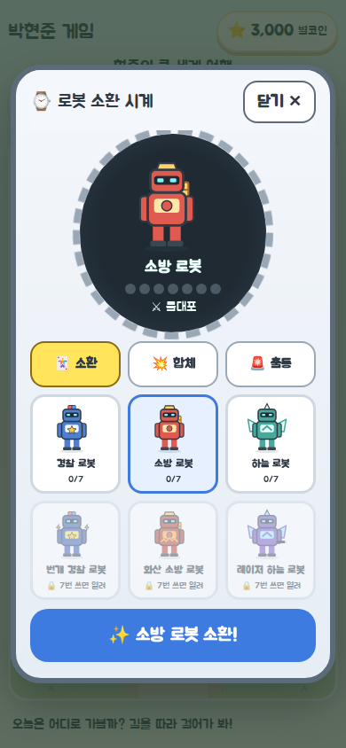
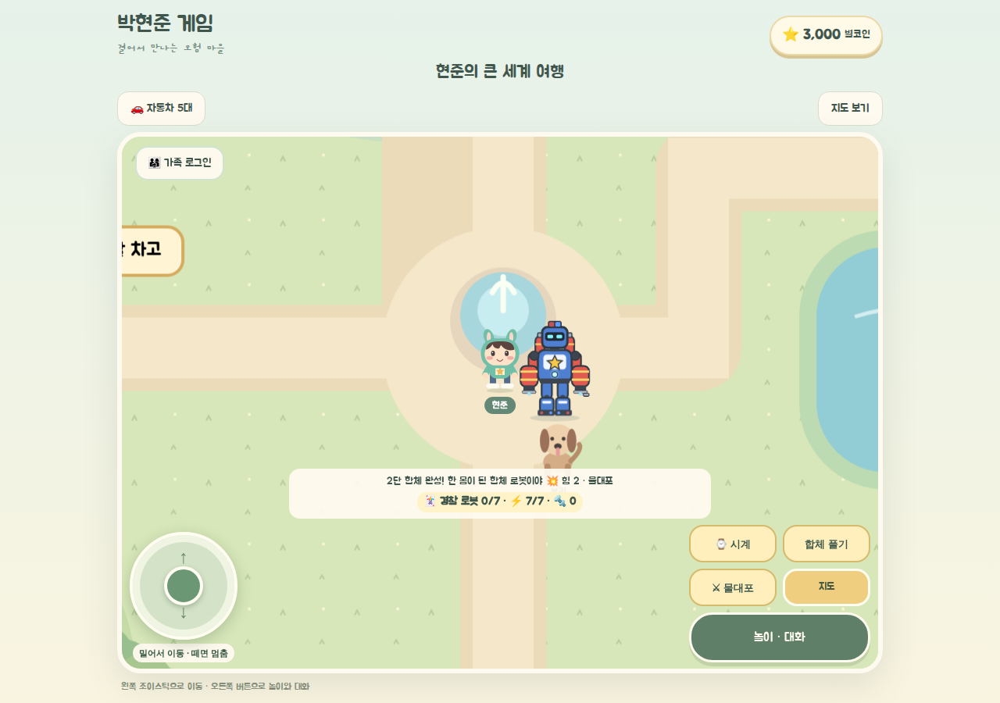
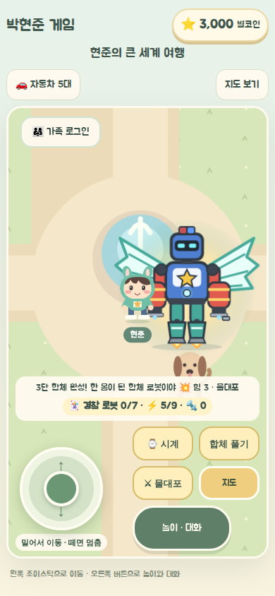
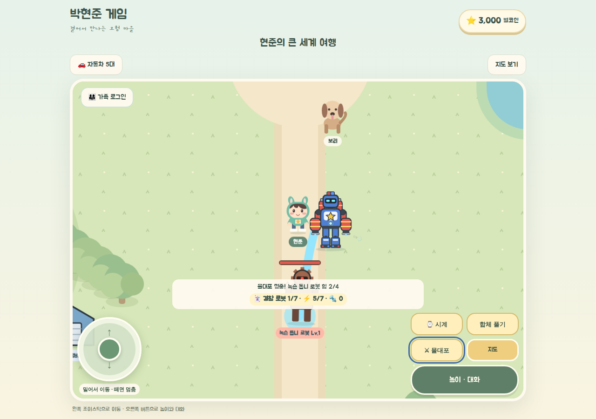
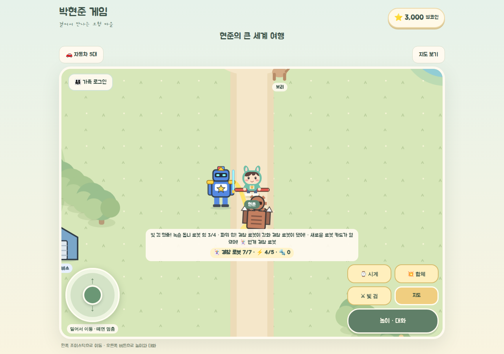
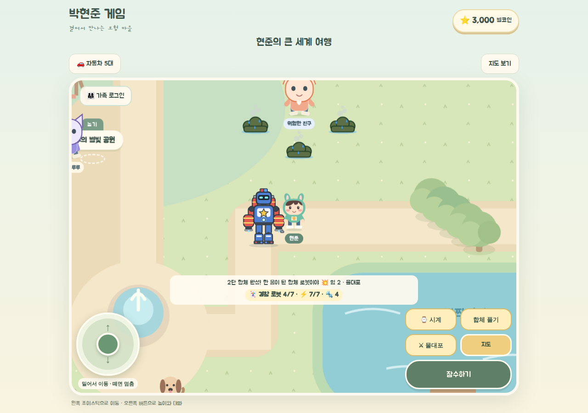
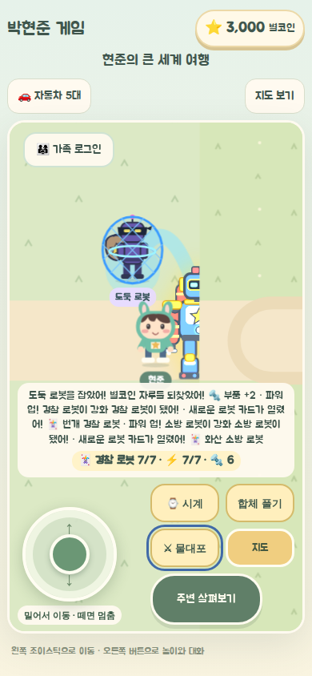
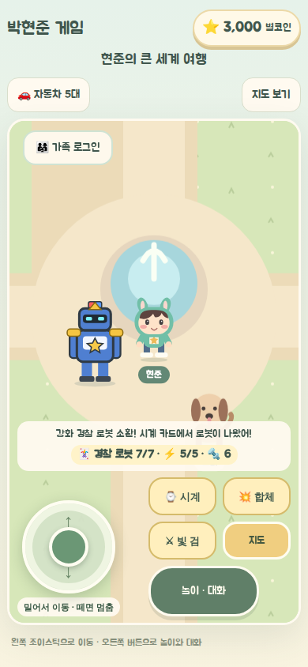

# 로봇 소환 시계 통합 — 2026-11-01

> 표기: **REQUEST**(현준이·보호자 요구) / **FACT**(코드·실행 기록) / **PROPOSED** / **UNKNOWN** / **NOT_RUN**.
> 브랜치 `feat/robot-watch-integration-20261101`. 기준 `main` = `bbc49fe`. PR #38 브랜치 끝(`91ec39a`)에서 이어서 만들었고, 이미 올라간 커밋은 다시 쓰지 않았다.

| 문서 | 내용 |
|---|---|
| [01_REQUIREMENTS_V2.md](01_REQUIREMENTS_V2.md) | 보호자가 정리한 요구사항 v2.0 원문 (REQUEST). 11월 1일 정정이 10월 31일 문서보다 우선 |
| [04_ACCEPTANCE_UAT_MATRIX.md](04_ACCEPTANCE_UAT_MATRIX.md) | 수락 기준 AT-01~AT-18 원문 |
| 이 문서 | 진단, PR #38/#39 통합 내역, 수락 테스트 결과, 남은 일 |

## 1. 결론

**PARTIAL — 게임 안 P0 흐름은 자동 브라우저 조작으로 전부 확인했다. 실기기와 현준이 직접 플레이는 NOT_RUN이다.**

시계를 열어 그림 카드를 고르고, 로봇을 불러 월드에서 움직인다. 2·3대를 한 몸으로 합체해 무기를 꺼내 악당을 후퇴시키고, 불꽃 덤불에 갇힌 친구를 구하고, 도망가는 도둑을 경찰 로봇으로 잡는다. 7번째 유효한 기술에 로봇이 실제로 강해진다. 새로고침해도 모두 남는다. 이 흐름이 휴대폰(390×844)·태블릿(1280×900) 헤드리스 브라우저에서 실제 터치·키 입력으로 반복된다(FACT).

## 2. 진단 (Phase 0)

- **PR #38** (`feat/robot-world-pr-b-20261101`): 월드 안 악당이 위치·힘·반격·후퇴·재등장·부품 보상을 실제로 가진 엔진. 2·3단 합체는 몸 뒤에 다른 로봇을 작게 그린 방식이라 v2 기준(한 몸)에 못 미친다.
- **PR #39** (`feat/robot-watch-fusion-20261101`, Draft): 시계 화면 배치와 저장 필드(`materials`, 전체 `grade`, `fusionBest`, `fusionCount`, `settled`)는 쓸 만했다. 다만 임무는 플레이어 옆에 임시 목표를 만들고 숫자만 줄이는 방식이라 친구·도둑 NPC가 없었고, 합체는 기록만 남겼다. GitHub Pages CI의 TypeScript 오류 3건이 있었다.
- 두 PR은 같은 `main`에서 출발해 같은 파일 7개를 서로 다르게 고쳤다. 그래서 그대로 합치지 않고, #38 엔진 위에 #39의 시계 UX를 새로 얹었다.

## 3. PR #38 / #39 통합 내역

| 항목 | 출처 | 처리 |
|---|---|---|
| 악당 위치·힘·반격·후퇴·재등장, 승리 번호로 한 번만 보상 | #38 | **유지** (`robot-engine.ts`) |
| 에너지 = 받은 공격 수로 계산 | #38 | **유지·보완**: 첫 합체에서만 에너지 추가, 분리·재합체로 다시 차지 않음 |
| 정비소 부품 강화 | #38 | **유지**: 이제 강화 → 강철 (7회가 일반 → 강화) |
| 마을을 돌아다니는 로봇을 만나서 타기 | #37/#38 | **폐기**: v2 "카드는 시계에 이미 저장" 정정. 소환은 시계로만 |
| 몸 뒤에 다른 로봇을 붙여 그린 `FusionArt` | #38 | **폐기**: 한 몸 `FusedRobotArt`로 교체 (머리·몸 = 1번, 팔·무기 = 2번, 다리·날개 = 3번) |
| 시계 화면(그림 카드, 미리보기, 합체 고르기, 출동 버튼) | #39 | **재작성** (`RobotWatch.tsx`): 탭 3개, 7칸 사용 표시, 합체 역할 표시, 휴대폰 스크롤 |
| 시계가 열리면 조이스틱 멈춤 | #39 | **유지** (Village가 시계 상태를 갖고 이동·생활 월드를 멈춤) |
| 임시 목표 + 숫자 감소 임무 | #39 | **폐기**: 월드 NPC 임무로 교체 (`robot-missions.ts`) |
| `materials`, 전체 `grade`, `fusionBest`, `fusionCount` 저장 | #39 | **읽기 지원**: `parts = max(parts, materials)`, 전체 등급은 모든 기본 로봇에 적용, 합체 기록은 유지 |
| TypeScript 오류 3건 (`Village.tsx` 2건, `useRobotWorld.ts` 1건) | #39 | 해당 코드를 다시 썼기 때문에 사라짐. 통합본 `npx tsc --noEmit` 오류 0 |

PR #38과 #39는 이 브랜치로 대체된다. **#38을 따로 병합하지 않는다.** 두 PR을 닫을지는 보호자가 결정한다.

## 4. 만든 것 (FACT, 코드 근거)

- **엔진** `src/game/robot-engine.ts`, `robot-missions.ts`, `robot-catalog.ts`
  - 기본 카드 3장(경찰·소방·하늘)이 처음부터 시계에 있다. 7번 쓰면 열리는 카드 3장.
  - 로봇마다 무기가 있다: 경찰 빛 검(사거리 170), 소방 물대포(260), 하늘 회오리 부메랑(220). 합체하면 팔을 맡은 로봇의 무기를 쓰고 1대당 사거리 +40.
  - `resolveStrike` 하나가 명중·너무 멀어·충전 중을 판정한다. 피해, 불 끄기, 도둑 잡기, 7회 계산이 모두 이 결과를 쓴다.
  - 7번째 유효 사용에 그 로봇이 일반 → 강화가 되고(힘 +1, 금색 장식), 다음 카드가 열린다. 둘 다 한 번만.
  - 친구 구조: 불꽃 덤불 3개. 유효 타격마다 1개(소방 팔이면 2개) 꺼짐 → 안전 → 고마워 → 부품 +2 (한 번만).
  - 도둑: 서쪽 들판(반경 380) 안에서 쫓는 로봇을 피해 걷는 속도보다 느리게 도망. 타격마다 힘 −1, 힘이 0이 되면 **경찰 로봇이 있을 때만** 체포 → 후퇴 → 부품 +2.
  - 저장: `GameState.version = 3`, 키 `hyunjun-game-v2` 그대로. 로봇은 각 기기에만 저장(가족방으로 보내지 않음).
- **화면** `useRobotWorld.ts`, `RobotWatch.tsx`, `RobotWorld.tsx`, `RobotActorView.tsx`, `FusedRobotArt.tsx`, `MissionArt.tsx`, `Village.tsx`(연결만)
  - 소환된 로봇은 자기 월드 좌표를 가진 actor다. 따라오기(플레이어 뒤 70) 또는 타기.
  - 합체: 모이기(따로 걸어옴) → 조립(부품이 날아와 붙음) → 한 몸. 분리: 흩어짐 → 다른 로봇들이 시계로 돌아감.
  - 오른쪽 버튼: `⌚ 시계`, `💥 합체`/`합체 풀기`, `⚔ 무기`, `지도` + 기존 행동 버튼. 임무 중에는 방향과 걸음 수를 안내한다(🧭).
  - **기존 화면이 바뀐 점 (보호자가 되돌릴 수 있는 결정):** 로봇이 나와 있는 동안에는 오른쪽 `차 타기` 버튼 자리에 `합체`·`무기`가 나온다. 그동안 차는 위쪽 `🚗 자동차` 버튼으로 타거나, 로봇을 시계로 돌려보낸 뒤 탄다. 버튼이 너무 많아지지 않게 하려는 것이다.
  - 차·비행기·잠수함·호수·건물에 들어가면 로봇은 시계로 돌아간다. 지도 이동 때는 따라온다.
  - 모든 actor·NPC 상태를 `data-*` 속성으로 노출한다(`data-robot-actor`, `data-fusion-phase`, `data-part-*`, `data-weapon`, `data-villain`/`data-hp`, `data-rescue`, `data-thief`). 브라우저 검사가 그림이 아니라 게임 상태를 확인한다.

## 5. 수락 테스트 (AT-01~AT-18)

증거: `scripts/verify-robot-world.cjs` 실행 로그(2026-11-01, headless Chromium, 1280×900 태블릿·390×844 휴대폰 터치), 저장값 확인, 아래 스크린샷.

| ID | 상태 | 확인한 사실 |
|---|---|---|
| AT-01 기존 마을 | PASS | 차 타기·지도·시계 버튼, 별코인 3,000 표시 |
| AT-02 시계 열기 | PASS | 카드 6장(3장 잠김), 카드를 누르면 시계 화면 미리보기가 바뀜. 카드를 끼우는 과정 없음 |
| AT-03 소환 | PASS | `data-team`이 고른 로봇. `summoning` → `active`. 플레이어와 다른 좌표 |
| AT-04 이동 | PASS | 따라오기: 플레이어가 250 움직이면 로봇 x가 150 넘게 따라옴. 타기: 로봇 좌표 = 플레이어 좌표 |
| AT-05 2단 합체 | PASS | `gathering` → `assembling` → `fused`. SVG 1개, `data-part-head=rb-police`, `data-part-arms=rb-fire`. 힘 2, 무기 물대포 |
| AT-06 3단 합체 | PASS | `data-fusion=3`, `data-part-legs=rb-sky`, 머리 크기가 2단보다 1.1배 넘게 큼, 힘 3, 합체 최고 3단 저장 |
| AT-07 합체 해제 | PASS | `splitting` → `returning` → `single`, 1번 로봇이 남음. 저장된 카드 그대로 |
| AT-08 무기 | PASS | 사거리 밖: "너무 멀어", 악당 힘·사용 횟수 변화 없음, 무기는 꺼내짐(`data-weapon=drawn`). 사거리 안: 힘 −2. 충전 중 다시 누르면 변화 없음 |
| AT-09 악당 | PASS | 힘 0 → `retreating`, 승리 1, 부품 2, 팀 두 로봇 사용 횟수 +2 |
| AT-10 7회 강화 | PASS | 6/7 저장에서 시작. 7번째 타격 힘 −1, 이후 `data-grade` 0 → 1, 다음 타격 힘 −2. 번개 경찰 카드 열림. 새로고침 후 "강화 경찰 로봇" |
| AT-11 친구 구조 | PASS | 🧭 안내 → 현장 이동 → `rescuing` → 덤불 3 → 1 → `safe` → `thanked`. 구조 1. 끄자마자 로봇을 돌려보내도 보상 유지 |
| AT-12 도둑 | PASS | 도둑 좌표가 혼자 바뀜(도망). 쫓아가 타격 → `caught` → `retreating`, 체포 1. 바로 다시 출동해도 이전 타이머가 새 도둑을 끝내지 않음 |
| AT-13 새로고침 | PASS | 로봇 저장 전체 동일, 별코인 3,000, 차 `car-021`과 엔진 업그레이드, `version: 3` |
| AT-14 휴대폰 터치 | PASS (헤드리스) | 시계·합체·무기·지도·행동 버튼이 화면 안, 높이 44px 이상. 시계는 스크롤되고 닫기는 계속 보임. 입력창 0개 |
| AT-15 기존 놀이 | PASS | 회귀 검사 3개 PASS(아래). 지도 이동 때 로봇이 따라오고, 건물에 들어가면 시계로 돌아감. 차고에서 차를 고르면 로봇이 시계로 돌아가고 차가 움직이며, 내리면 시계 버튼이 돌아옴. 비행기·잠수함·호수는 같은 코드 경로(`robotAllowed`)지만 브라우저로는 NOT_RUN |
| AT-16 강철 이상 성장 | PARTIAL | 강철까지(정비소). 황금·다이아는 P1 |
| AT-17 황금 강철 지역 | NOT_RUN | 미구현 (P1) |
| AT-18 5·10·20단, 200종·100단 | NOT_RUN | 합체 팀·파츠는 데이터로 늘릴 수 있게 둠. 단계 연출은 P1/P2 |
| 화면 회전·큰 글씨·더 작은 화면 | NOT_RUN | 04 문서 §4 시각 QA 항목 |
| 가족방 성능 `verify-family-performance.cjs` | NOT_RUN | 로컬 Auth/Realtime 시험 서버와 별도 빌드가 필요(`docs/multiplayer/PLAN_SUPABASE_2026-10-20.md`). 가족방 코드는 바꾸지 않았고 로봇은 가족방으로 보내지 않는다. `verify-living-world.cjs`의 p95 17ms는 그림 부담의 대신 지표일 뿐 가족방 확인이 아니다 |
| 삼성 브라우저·S Pen 실기기 | NOT_RUN | |
| 현준이 직접 플레이 | NOT_RUN | 보호자 확인 전 |

## 6. 실행한 명령

| 명령 | 결과 |
|---|---|
| `bun install --frozen-lockfile` | PASS (변경 없음) |
| `npm test` | PASS 137/137 (로봇 12개) |
| `npx tsc --noEmit` | PASS, 오류 0 |
| `npm run lint` | PASS, 오류 0. 경고 8개는 모두 기존 파일(`src/components/ui/*`, `Garage.tsx`의 fast-refresh 경고) |
| `npm run build` | PASS |
| `npm run build:pages` | PASS |
| `scripts/verify-robot-world.cjs` | PASS (위 AT 표) |
| `scripts/verify-building-interiors.cjs` (전체) | PASS |
| `scripts/verify-child-play.cjs` | PASS |
| `scripts/verify-living-world.cjs` | PASS, 성능 p95 17ms |

Codex 독립 리뷰에서 나온 5건(미션 타이머가 새 미션을 건드림, 로봇을 돌려보내면 구조 보상이 사라짐, #39 전체 등급 일부 누락, 분리·재합체로 에너지 회복, 탄 상태 합체 그림 누락)은 모두 고쳤고, 위 검사에 재현 단계를 넣었다.

## 7. 화면

## 8. 남은 일

- **P1:** 황금·다이아·궁극 등급과 그림, 자동차·바다·공룡·강철 계열, 황금 강철 지역과 보스, 5·10·20단 합체 연출, 화재·사고 등 추가 임무.
- **P2:** 200종 수집(실루엣 차이 규칙 테스트), 100단 합체, 가족방 협동 로봇.
- **UNKNOWN (현준이 확인):** 따라오기와 타기 중 무엇을 더 좋아하는지, 무기 모양, 악당·제국 이름, 시계 이름. 화면 이름(경찰 로봇 등)은 상표 검색 전까지 설명형이다.
- **실기기:** 삼성 브라우저·S Pen·현준이 직접 플레이로 버튼 크기와 도둑 속도를 조정한다.
