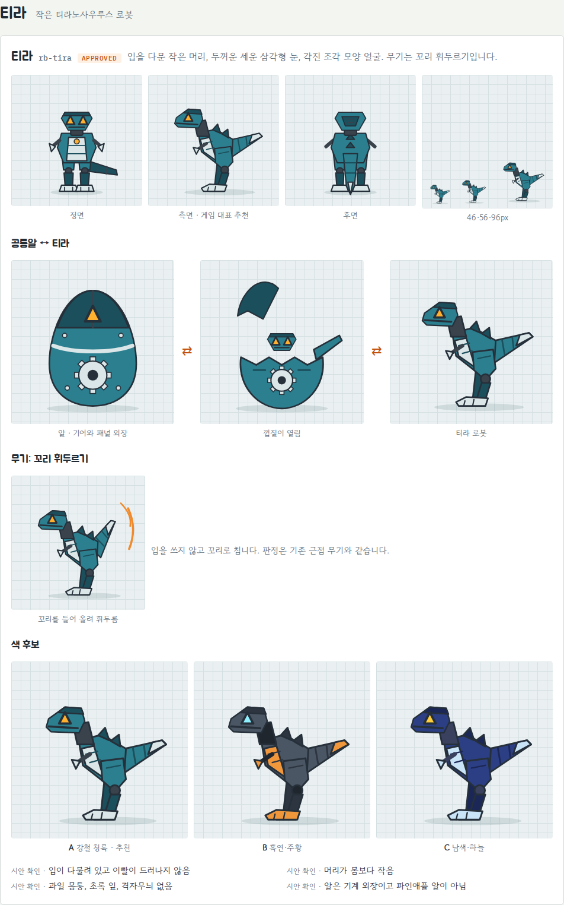
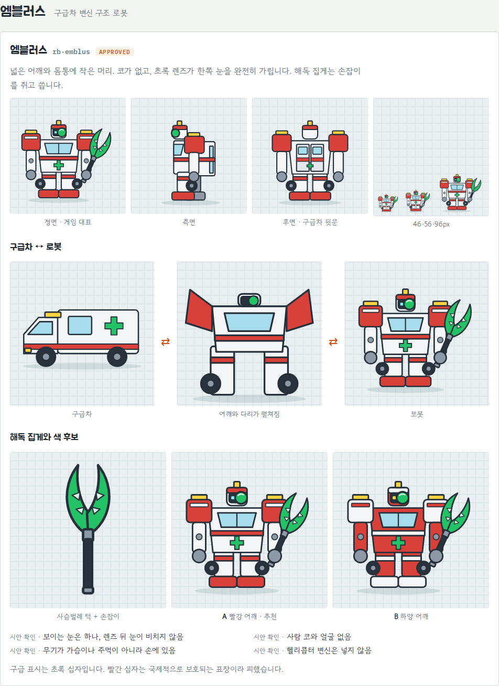
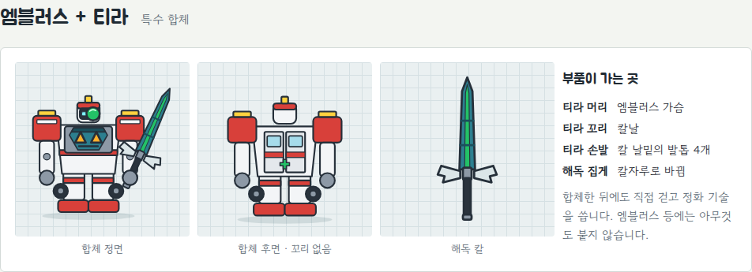
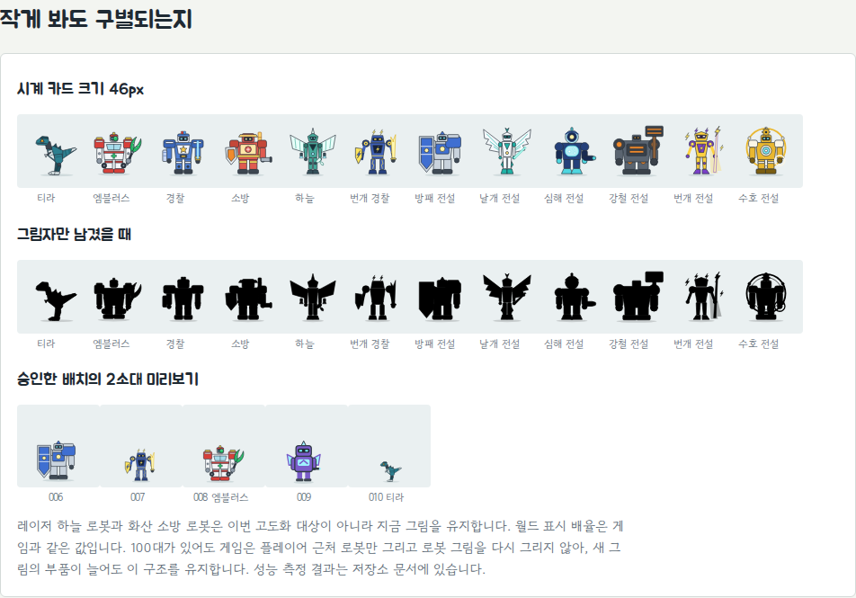
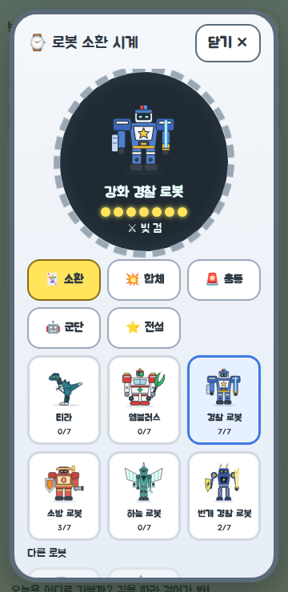
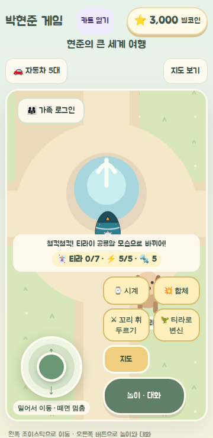
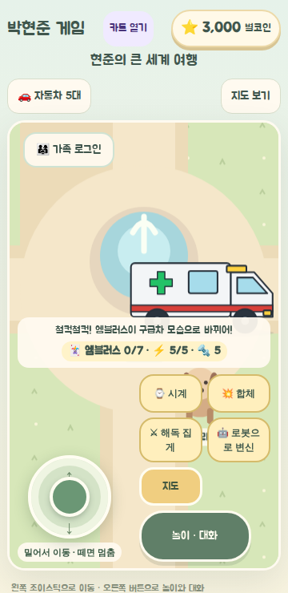
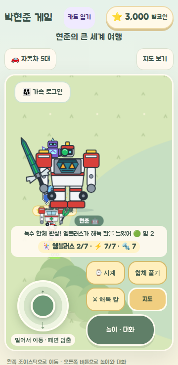
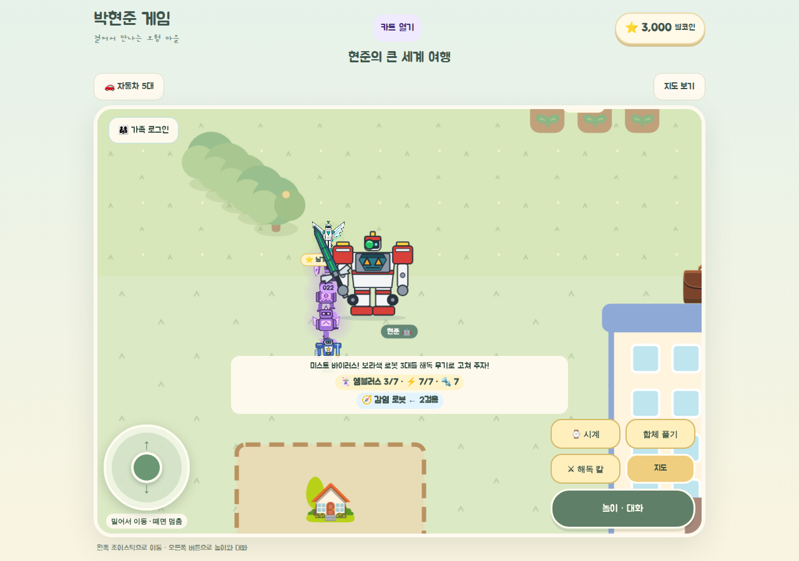
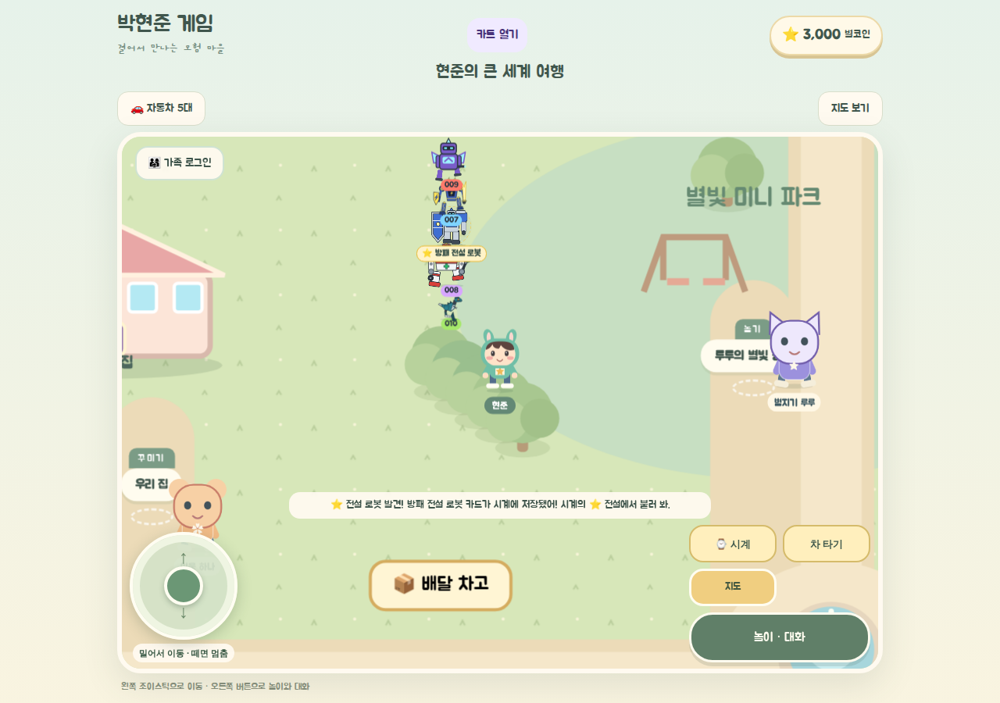

# 로봇 100대 유지·주요 6종·전설 6종 (2026-11-02)

> 상태: 구현 완료, 작업 브랜치 `feat/robot-roster-100-20261102`. **병합 전**이며 실기기 확인은 `NOT_RUN`이다.
> 기준 코드: `main@37199ae`. 입력: 보호자의 로봇 편성·디자인 지시서 v1.1 (저장소 밖 보관).

월드 군단은 100대 그대로 두고, 신규 로봇 티라와 엠블러스를 기존 슬롯 2개에 넣었다. 주요 6종과 전설 6종은 승인한 시안의 그림으로 바꿨다.
아이가 그린 원본 사진은 공개 저장소에 올리지 않는다. 이 폴더의 그림은 그 사진이 아니라 승인된 정제 시안이다.

## 수량 (FACT, 테스트로 고정)

| 구분 | 값 | 비고 |
|---|---|---|
| 군단 개체 | 100 | 고유 `instanceId` 100개. 이전 군단과 달라진 개체는 정확히 2개 |
| 주요 로봇 | 6종 | `rb-tira`, `rb-emblus`, `rb-police`, `rb-fire`, `rb-sky`, `rb-thunder-police` |
| 전설 로봇 | 6종 | 기존 ID·이름·해금 위치 유지 |
| 전체 종 | 14종 | 기존 12종 + 신규 2종. `rb-volcano-fire`, `rb-laser-sky`는 시계의 "다른 로봇"에 유지 |
| 저장 버전 | 3 | 저장 키·버전 변경 없음. `robots.cures` 하나만 추가되고 옛 저장에서는 0 |

## 보호자 결정 (2026-11-02)

| 항목 | 결정 |
|---|---|
| 기존 주요 4종 | 경찰, 소방, 하늘, 번개 경찰 |
| 군단 배치 | 시작점에서 가까운 2소대에 나란히. 소대장 슬롯은 건드리지 않음 |
| 신규 2종 획득 | 처음부터 시계에 있음. 옛 시계 저장의 일괄 등급은 받지 않음 |
| 계열 | 새 `rescue` 계열. 불꽃은 1개씩 끄고 도둑은 체포 못 함 |
| 합체 | 티라+엠블러스 전용 특수 합체(순서 무관). 일반 합체에는 참여하지 않음 |
| 티라 무기 | 꼬리 휘두르기. 기존 근접 판정 사용 |
| 미스트 바이러스 | 출동 탭 임무. 근처 군단 최대 3대가 실행 중에만 감염. 해독 무기는 감염 로봇만 조준하고, 7회 성장은 해독 명중으로 쌓임 |
| 외형 | 12종 시안 승인. 티라 색 A(강철 청록), 엠블러스 색 A(빨강 어깨), 티라는 게임에서 측면 |

### 승인 후 구현 중 바꾼 것

- **슬롯 주인 교체:** 승인안은 `army-008`=티라, `army-010`=엠블러스였다. 구현 후 화면에서 큰 엠블러스가 앞 칸의 티라를 가려서 `army-008`=엠블러스, `army-010`=티라로 바꿨다. 슬롯 2개와 개체 수는 같다. **보호자 재확인 대상.**

## 동작

- **변신:** 티라 공룡알↔로봇, 엠블러스 구급차↔로봇. 변신 상태는 저장하지 않아 새로고침하면 로봇으로 돌아온다. 변신 중이거나 다른 모습이면 무기를 쓸 수 없다.
- **해독:** 임무 시작 → 감염 로봇이 보라색으로 변함 → 걸어가서 무기로 명중 → 정상 복귀. 빗나가면 아무것도 바뀌지 않고, 모두 고치면 부품 2개를 한 번만 받는다.
- **특수 합체:** 티라 머리가 엠블러스 가슴으로, 꼬리·손발이 해독 칼로 간다. 등에는 꼬리가 없다. 합체 후에도 걷고 해독한다.
- **100대 합체와의 관계:** 군단을 부르면 미스트가 보상 없이 걷히고, 군단이 움직이는 동안에는 해독 임무를 시작할 수 없다.
- **월드 크기:** 경찰 로봇을 1로 볼 때 엠블러스 1.2배, 티라 0.72배. 시계 카드는 읽기 좋게 같은 크기다.

## 수락 결과 (2026-11-02, 커밋은 PR 참고)

기록 방식: `PASS | FAIL | BLOCKED | NOT_RUN`. 브라우저는 headless Chromium, 360×740과 1280×900. CI와 실기기는 별도로 본다.

| ID | 항목 | 수준 | 결과 | 근거 |
|---|---|---|---|---|
| AC-01·02 | 100대, 차이 2건, 소대장 불변 | unit | PASS | `robot-roster.test.ts` |
| AC-03~05 | 주요 6, 전설 6, 전체 14 | unit | PASS | `robot-roster.test.ts` |
| AC-06 | 옛 카드 12종 보존 | unit+browser | PASS | `robot-roster.test.ts`, `verify-robot-roster.cjs` |
| AC-07 | 잠금·미등록 소환 거부 | unit | PASS | `robot-roster.test.ts` |
| AC-08·09 | 변신 왕복 | unit+browser | PASS | `robot-forms.test.ts`, `verify-robot-roster.cjs` |
| AC-10~14 | 티라·엠블러스 외형 | visual | PASS (시안 승인), 게임 렌더 재확인 대기 | 아래 이미지. 보호자가 게임 화면을 본 기록은 아직 없음 |
| AC-15 | 감염→접근→명중→복귀 | browser | PASS | `verify-robot-roster.cjs` |
| AC-16 | 빗나감·쿨다운 | unit+browser | PASS | `robot-infection.test.ts` |
| AC-17·18 | 특수 합체, 카드 보존 | unit+browser | PASS | 같은 스크립트 |
| AC-19·20 | 주요·전설 구별 | visual | PASS (시안 승인), 게임 렌더 재확인 대기 | `sheet-silhouettes.png` |
| AC-21 | 100대 집결·거대 합체 | browser | PASS | `verify-robot-army.cjs` |
| AC-22 | 버전 3 옛 저장 | unit+browser | PASS | 같은 테스트 |
| AC-23 | 변신 중 새로고침 | browser | PASS | `verify-robot-roster.cjs`. 해독 중 강제 종료는 저장 대상이 없어 코드 확인만 함 |
| AC-24 | 보상 1회 | unit+browser | PASS | `robot-infection.test.ts` |
| AC-25 | 가족방 권한 | unit | PASS (변경 없음) | `family-*.test.ts`. 실제 Supabase 접속은 `NOT_RUN` |
| AC-26 | 360px 터치 경로 | browser | PASS, 일부 한계 | 버튼은 터치 기기 설정에서 클릭. 군단 이동은 키보드로 해서 조이스틱 이동은 이 스크립트에서 `NOT_RUN` |
| AC-27 | 성능 | browser | 측정만 | `verify-robot-army.cjs` RA-AT-21. 기기별 기준선 미설정, 실기기 `NOT_RUN` |
| AC-28 | 카트 허브·방 깨기·땅콩·온실 | browser | PASS | `verify-kart-hub`, `verify-room-escape`, `verify-peanuts`, `verify-greenhouse`. 러너 조작과 농장 밭은 직접 조작 `NOT_RUN`(저장 값 보존만 확인) |
| AC-29 | `npm run check`, `build:pages` | build | PASS | 로컬. CI는 PR 후 |
| AC-30 | 원본 사진 비공개 | artifact | PASS | 저장소에 사진 없음 |

**실기기 UAT 전체 `NOT_RUN`:** 휴대폰에서 터치로 소환·변신·해독·합체, 아이 반응, 체감 성능.

## 알려진 한계

- **상태 안내판 겹침:** 360×740 화면에서 하단 안내판이 탄 로봇의 발을 가린다. 기존 화면 구조에서 생긴 문제로 다른 로봇에도 같고, 작은 티라에서 더 눈에 띈다. 이번에 고치지 않았다.
- **일반 합체 그림:** 기존 2·3단 합체는 계열별 예전 부품으로 그린다. 혼자 있을 때의 새 그림과 같지 않다.
- **보조 2종:** 화산 소방과 레이저 하늘은 이번 고도화 대상이 아니라 이전 그림이다.
- **무기 표현:** 무기를 항상 들고 있다. 사용하면 번쩍이고 휘두르는 동작만 더해진다.
- **측면·후면 시안:** 게임은 측면(티라)이나 정면(나머지) 한 방향만 쓴다. 나머지 방향은 설명용이다.

## 코드 위치

- 규칙: `src/game/robot/robot-catalog.ts`, `robot-army.ts`, `robot-engine.ts`, `robot-forms.ts`, `robot-infection.ts`
- 그림: `src/components/hyunjun/RobotRosterArt.tsx`, `LegendBodies.tsx`, `robot-art-kit.ts`
- 연결: `useRobotWorld.ts`, `RobotWatch.tsx`, `RobotArmyView.tsx`, `Village.tsx`
- 브라우저 검사: `scripts/verify-robot-roster.cjs`

## 승인 시안과 게임 화면

| 티라 | 엠블러스 |
|---|---|
|  |  |

| 시계 카드 (360px) | 공룡알 (360px) | 구급차 (360px) | 특수 합체 (360px) |
|---|---|---|---|
|  |  |  |  |

## 다음 할 일

1. 보호자·아이가 실제 게임 화면 확인, 슬롯 교체 재확인.
2. 휴대폰 실기기 UAT.
3. (DEFERRED) 6~12대 합체, 신규 10종, 추가 전설, 신규 2종의 일반 합체 참여.
