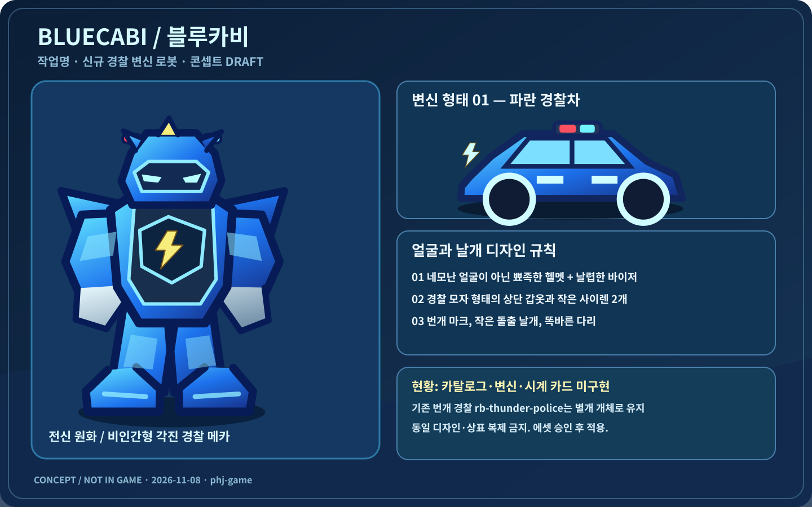
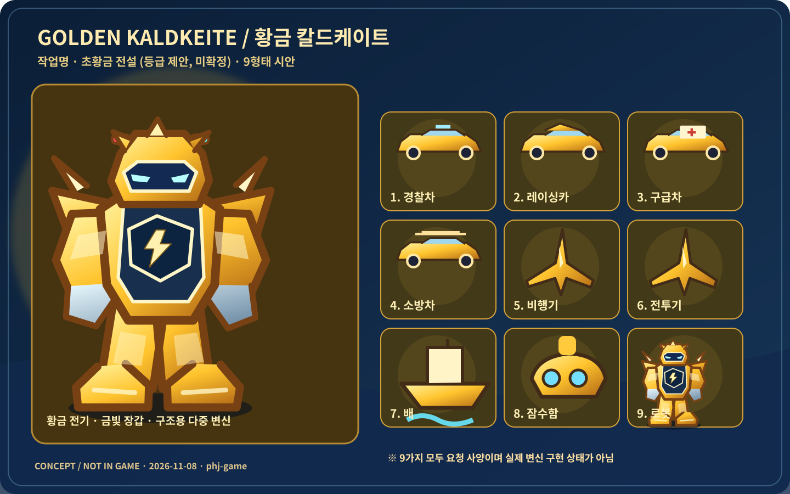

# 블루카비·황금 칼드케이트 로봇 추가 — 라이브 캐치업·시각 사양 (2026-11-08)

> **상태:** FACT(라이브 GitHub 코드 확인) / REQUEST(아동 구술) / PROPOSED(구현 방향) / DECISION REQUIRED(보호자 승인 필요) / NOT_RUN(미검증). 이 PR은 상세 구현 **인계용 초안**이며 실제 로봇 추가 구현 완료가 아니다. 
> **대상 저장소:** `haapy-mind-life/phj-game`, GitHub Pages `/phj-game/`.
> **기준 main SHA (조사 시점):** `e6aef0f447d49f0e9bb0c6c2029d5401eae9772e`, 이전 `6532c71`이 아님.
> **작업 브랜치:** `feat/robots-bluecabi-golden-20261108`.
> **기존 PR:** #53 시작/로딩은 병합 완료, #51 티라·엠블러스는 병합 완료, #42 100대 군단과 전설 6종은 병합 완료. #39는 미병합 종료.

## 1. 코드/사용자 요청 대비 (FACT)

| 주제 | 코드상 확인 | 기대 | 판정 |
|---|---|---|---|
| 시작 화면 | `WorldEntry.tsx`에서 `rb-thunder-police` 그림 재사용 | 블루카비 본모습 | **미반영** |
| 블루카비 | `robot-catalog.ts`에 ID 없음, `robot-forms.ts`에 변신 없음 | 경찰 로봇/경찰차/에너지 능력 | **미구현** |
| 황금 칼드케이트 | 카탈로그 ID/변신 정의 없음 | 9형태 초황금 전설/황금 전기 | **미구현** |
| 로봇 기지 | `adventure.ts`에 `planned` 게이트 | 실제 로봇 상호작용 | **미구현** |
| 엠블러스 | `rb-emblus`, 구급차 변신/해독/티라 특수합체 | 칼드케이트와 합체·동시 성장 | **부분 구현 + 규칙 충돌** |
| 티라 | `rb-tira`, 알↔로봇·해독 특수합체 | 기존 유지 | **구현** |
| 전체 규모 | 14종(`ALL_ROBOTS`), 실제 군단 100개체, 전설 6종 | 신규 2종 추가 | **새 종류의 군단 편입 여부 미결정** |

## 2. 상세 캐릭터 외형 시안 (ORIGINAL CONCEPT / 승인 전)

### A. 블루카비 (작업명)

- **역할:** 소환 시계에서 호출 가능한 경찰 영웅 로봇. 기존 번개 경찰(`rb-thunder-police`)의 **별개 로봇**이다.
- **머리:** 네모 얼굴 금지. 각진 쐐기형/약간 뾰족한 하단 턱, 사람·동물 얼굴이 아닌 메카 바이저. 과도하게 홀쭉하지 않게.
- **헬멧:** 경찰 모자 실루엣, 번개 문양, 작은 사이렌 **두 개**. 커다란 경광등이나 과장된 헤드 기어 금지.
- **몸:** 파란색+하늘색 하이라이트, 백색/은빛 다리, 금빛 번개 포인트. 다리는 구불구불하지 않게, 정렬된 기계식 구조.
- **날개:** 경찰차와 로봇 양쪽에서 조금 튀어나온 **작은 날개**. 과장된 큰 천사 날개 금지.
- **차량:** 귀엽되 강인한 파란 경찰차로 변신. 차량 상태에서도 전방 시야 확보.
- **능력 제안:** 사이렌·번개·에너지 부스터. 실제 공격 방식/수치/합체 대상은 기존 룰과 대조한 뒤 결정한다.
- **이름:** `workName = "블루카비"`; 공식 표시는 기존 `workName + 설명형 표시 이름` 계약을 따른다. 예: `name = "푸른 번개 경찰 로봇"`. 상표 확인 전 영구 확정 이름으로 간주하지 않는다.
- **참조:** 기존 `rb-thunder-police` 스타일과 `RobotRosterArt.tsx`의 로봇 렌더 방식은 참고하되 신규 실루엣은 명확하게 구별한다.

### B. 황금 칼드케이트 (작업명)

- **등급 콘셉트:** 일반 전설보다 특별한 **초황금 전설**(요청). 현재 전설 등급/해금 구조와 별개로 검토하며 기존 `LEGENDS` 6종을 묵시적으로 7종으로 변경하지 않는다.
- **얼굴:** 뾰족한 금빛 메카 헬멧, 중앙 번개/금빛 전기 표식, 로봇다운 바이저와 비인간형 얼굴. 기존 엠블러스와 동일 얼굴/실루엣 금지.
- **색:** 밝은 황금색, 샴페인 골드, 어두운 금속 관절, 푸른 전기 코어. 화면의 흰 배경에서도 구분되는 명도·외곽선.
- **기본 로봇:** 경찰/구조/비행/항해 능력이 합쳐진 다목적 전설 로봇. 좌우 대칭의 다리·팔·작은 측면 날개.
- **변신 목록(총 9형태):** 로봇, 경찰차, 레이싱카, 구급차, 소방차, 비행기, 전투기, 배, 잠수함.
- **황금 전기:** 펭귄 얼음 깨기에서 수집 → 칼드케이트 충전·성장 → 연결된 엠블러스 동시 성장. 현재는 **요청/제안**으로 기록만 하며 실제 화폐·저장 필드 추가는 별도 보호자 결정.
- **합체:** 블루카비, 엠블러스와 합체 가능(아동 요청). **기존 엠블러스 티라 전용 특수합체 규칙에 충돌**하므로 승인된 규칙이 나올 때까지 엔진 변경 금지.
- **이름:** `workName = "황금 칼드케이트"`, 설명형 표시 이름 예시 `"초황금 다중 변신 로봇"`. 외부 작품의 고유 디자인을 복제하지 않는다.

### C. 엠블러스 — 재구현 금지, 기존 승인 에셋 유지

| 구분 | 기존 구현 참고 |
|---|---|
| 기존 캐릭터 시트 | [sheet-emblus.png](../2026-11-02-roster-100/images/sheet-emblus.png) |
| 구급차 실제 스크린샷 | [phone-05-ambulance.png](../2026-11-02-roster-100/images/phone-05-ambulance.png) |
| 티라-엠블러스 합체 | [sheet-special-fusion.png](../2026-11-02-roster-100/images/sheet-special-fusion.png) |
| 게임 시계 모습 | [phone-01-watch-cards.png](../2026-11-02-roster-100/images/phone-01-watch-cards.png) |

- 기존 `rb-emblus`: 빨간 어깨+백색/구급 의료 장식, 소형 머리, 단안 렌즈, 해독 집게, 구급차↔로봇.
- 기존 `rb-tira`와 **순서 무관 전용 특수합체**. 일반 합체에는 참여하지 않음 (PR #51).
- 엠블러스의 기존 치료 및 미스트 바이러스 해독 동작을 변경하지 말 것.
- **신규 칼드케이트와의 결합은 기존 규칙 변경이므로 승인 전 구현하지 말 것.**

## 3. 아동 구술 원문 취지로 보존할 요구사항 (REQUEST)

- 블루카비처럼 멋지고 잘생긴 파란 경찰 메카. 얼굴은 네모나 홀쭉한 형태가 아니라 날렵하게 뾰족하고 경찰 모자·번개 장식·작은 사이렌 두 개.
- 황금 칼드케이트는 전설보다 특별한 황금 전설이며 황금 전기를 먹어야 성장.
- 로봇·경찰차·레이싱카·구급차·소방차·비행기·전투기·배·잠수함으로 변신. 엠블러스와 구별되게.
- 블루카비와 엠블러스와 합체할 수 있고, 연결된 엠블러스도 황금 전기 충전 시 같이 성장.
- 펭귄 얼음 깨기에서 황금 전기를 수집.
- 경찰 롤러코스터는 경찰차만의 일반 운전이 아니라 앞을 보며 레일을 도는 미니게임. 작은 돌출 날개, 코인→날개 업그레이드, 장애물에 닿으면 아웃, 악당에게 에너지 발사.
- 기존 월드·캐릭터·로봇 그림의 품질/귀여움을 높이되 외부 작품의 구체적인 캐릭터 디자인은 그대로 복제하지 않음.

## 4. 구현 담당자가 따라야 할 코드 경로 (FACT / AUDIT TARGET)

| 파일 | 용도/주의 |
|---|---|
| `src/game/robot/robot-catalog.ts` | 현재 `RobotSpeciesId`, `ROBOTS`, `LEGENDS`, `ALL_ROBOTS`, `FEATURED_MAIN`, `workName` |
| `src/game/robot/robot-forms.ts` | 현재 변신 유니온 `robot`/`egg`/`ambulance`; 신규 9형태 연결 시 exhaustive switch 점검 |
| `src/game/robot/robot-engine.ts` | `isRobotId`, 저장 카드 normalize, `validFusion`/특수합체, 해금 조건 |
| `src/game/robot/robot-army.ts` | 100대 고유 instance, 6 전설, 기존 슬롯 (변경하지 않을 것) |
| `src/components/hyunjun/RobotPortrait.tsx` | 시계/월드 동일 일러스트 라우팅 |
| `src/components/hyunjun/RobotRosterArt.tsx` | 기존 티라/엠블러스/특수합체 렌더 |
| `src/components/hyunjun/LegendaryRobotArt.tsx` | 기존 전설 6종 렌더 |
| `src/components/hyunjun/RobotWatch.tsx` | 로봇 시계 5탭/선택/합체 UI |
| `src/components/hyunjun/useRobotWorld.ts` | 월드 로봇 상태·변신 상태·액션/에너지 |
| `src/components/hyunjun/WorldEntry.tsx` | 시작 화면 임시 `rb-thunder-police` 대체 표시 |
| `src/game/world/adventure.ts` | 준비 중 로봇 기지 게이트 |
| `src/game/play/kart-catalog.ts` | 큰 20/미니 20 목록, status planned/playable/existing |
| `src/lib/world-model.ts` | `hyunjun-game-v2`, `version: 3` 저장 계약 |

## 5. 구현 단계 구분 (PROPOSED, 승인 게이트)

**Phase A — 지금 인계 대상 / 안전한 범위**
1. main/PR/로컬 변경 상태 감사, 신규 로봇 존재 여부 재확인.
2. 캐릭터별 오리지널 원화 및 **실제 게임 표시용** SVG/TSX 에셋 제작. 폰 360×740·390×844/태블릿·월드·시계 카드 크기에서 가독성 검증.
3. 기존 100대 군단 및 전설 6종은 그대로 둔 상태에서 신규 로봇 카탈로그 엔트리와 표시/미리보기/시계 카드 연결을 **별도 승인된 구현 브랜치**에서 수행할 수 있도록 계획 정리. 기존 `FEATURED_MAIN` 6종 제한 유지 방법 설명.
4. 검증과 스크린샷/테스트 증거를 포함한 Draft PR 작성 및 보호자 확인.

**Phase B — 별도 결정 후**
- 실제 9형태 변신 엔진과 게임 플레이 연결, 능력별 상호작용.
- 칼드케이트의 신규 획득 방법(즉시 보유 / 전설 발견 / 별도 해금).
- 엠블러스 기존 합체 룰 개정, 황금 전기 수집/성장/연동.
- 신규 저장 데이터/경제/수조/펭귄 얼음 깨기/롤러코스터.

## 6. 결정 게이트 (DECISION REQUIRED)

| ID | 질문 | 승인 전 기본 동작 |
|---|---|---|
| R-01 | 블루카비/칼드케이트 이름과 원화 최종 승인? | 작업명/오리지널 콘셉트만 사용 |
| R-02 | 기존 14종 외에 2종을 시계에 **추가**할지 기존 2종을 **교체**할지? | 기존 14종과 100대 군단 불변 |
| R-03 | 황금 칼드케이트를 별도의 초황금 전설로 해금? 기존 전설 6종 변경? | 기존 전설 6종 불변 |
| R-04 | 엠블러스 티라 전용 합체를 예외로 확장할지? | PR #51 합체 규칙 유지 |
| R-05 | 황금 전기를 화폐로 만들지, 임시 능력 게이지로 만들지? | 화폐/저장 신규 필드 금지 |
| R-06 | 연결 성장에 어떤 수치/레벨/해금 조건을 사용할지? | 7회 카드 사용·정비소 강철 강화 유지 |
| R-07 | 9형태를 한 PR에서 전부 구현할지 단계별 구현할지? | 그래픽/설계 선행, 실제 변신 별도 승인 |
| R-08 | 공개 저장소의 사용자 실명과 새 에셋의 공개 범위? | 기존 브랜딩만 유지, 신규 개인 사진/아동 원본 업로드 금지 |

## 7. 작업 완료 검증 및 보고 (NOT_RUN until tested)

- `npm run check`, `npm run build`, `npm run build:pages`
- `node scripts/verify-robot-roster.cjs`, `node scripts/verify-robot-army.cjs`, `node scripts/verify-world-entry.cjs` (환경에 따라 실행 가능 여부 구분)
- 시계/월드/시작 화면 캐릭터 일관성, 새 로봇 명칭/전신/변신 에셋, 클릭·터치·변신 회복, 직접 #/race 접근.
- 100대 군단, 6 전설, 기존 티라·엠블러스 합체, 7회 강화, 보유 카드, 이전 로컬 세이브의 복원.
- GitHub Pages `/phj-game/` 경로. CI 성공과 삼성 브라우저·S Pen 실기기 UAT는 별도로 표기.
- 검증 증거는 테스트 파일 경로/실제 결과/한정된 스크린샷으로 남김. 실행하지 않은 테스트는 `NOT_RUN`.

**중요:** 첨부 SVG는 구현을 위한 오리지널 기획용 콘셉트이며 실제 플레이 로봇으로 통합된 이미지가 아니다. 실제 게임 렌더러/에셋/변신 프레임은 로컬 에이전트가 구현하고 검증해야 한다.
