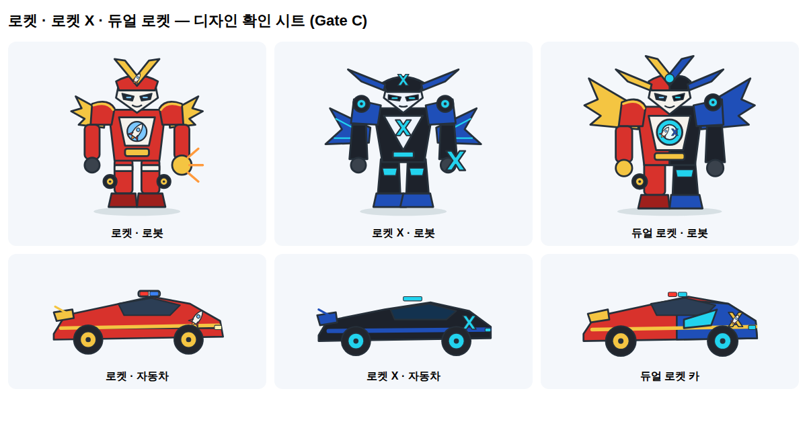
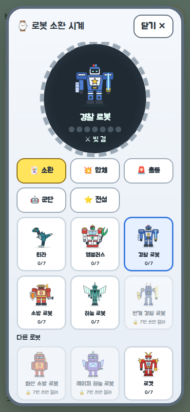
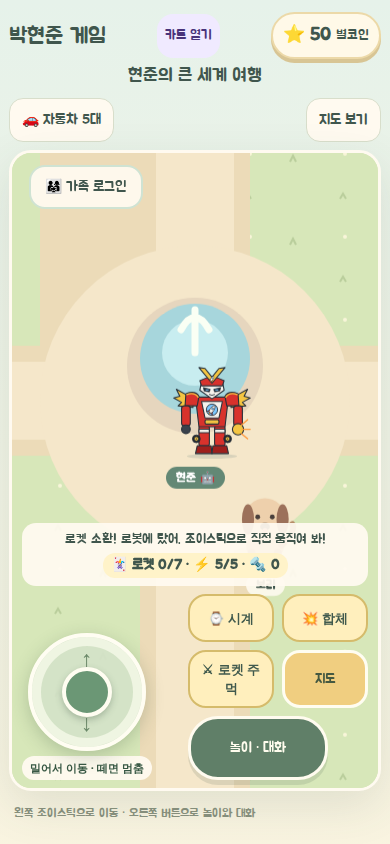
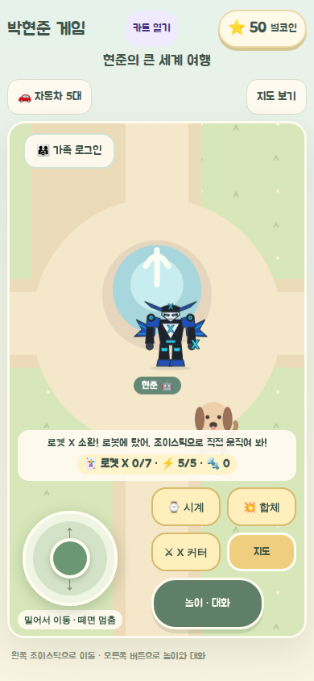

# 로켓 · 로켓 X · 듀얼 로켓 v1 (2026-11-08)

> 표기: FACT · REQUEST · PROPOSED · UNKNOWN · NOT_RUN. 작업지시서 패키지(로컬 전달본, 저장소에 넣지 않음)의 세션 S00~S06을 따른다.
> 기준: `origin/main` `e6aef0f`, 브랜치 `feat/rocket-dual-20261108`.

## 1. 요구 (REQUEST, 현준이 구술)

- 로켓과 로켓 X는 **친구인 서로 다른 로봇 두 대**다. 얼굴은 네모가 아니라 **뾰족하고 날렵하게**.
- 둘 다 **자동차로 변신**한다. 색만 다른 게 아니라 얼굴·어깨·바퀴·날개가 달라야 한다.
- 둘이 **진짜 한 몸으로 합체**하고, 합체에는 **기다리는 시간과 단계**가 있다.
- 스마트폰 터치로 조작한다.

이번 범위가 아닌 것: 티라 외형 수정, 골드·에메랄드·다이아몬드 삼총사, 로봇 미니게임, 롤러코스터(각각 별도 트랙).

## 2. 결정 (Gate B 승인, 2026-11-08 — 기본값)

| ID | 결정 | 상태 |
|---|---|---|
| Q-01 | 합체 시간 10초, 4단계(준비 0~2 · 에너지 연결 2~4 · 합체 변형 4~7 · 완성 7~10초). 상수 하나(`DUAL_FUSION_MS`) | PROPOSED, S05 체감 검사 후 재확인 |
| Q-02 | 합체 이름 「듀얼 로켓」 | PROPOSED |
| Q-03 | 두 로봇 모두 처음부터 시계에 있음(등급 0) | 결정 |
| Q-05 | 로켓+로켓 X끼리만 합체. 다른 로봇과는 합체하지 않음 | 결정 |
| Q-06 | 합체 자동차는 직접 타고 조이스틱으로 이동(기존 로봇 탑승 재사용) | 결정 |
| Q-07 | 100대 군단에 넣지 않음 | 결정 |
| Q-08 | 시안 포스터 PNG는 공개 저장소에 넣지 않음. 게임 그림은 직접 그린 SVG | 결정 |
| Q-04 | 무기는 기존 근접 무기 종류 재사용(로켓 주먹 · X 커터). 새 전투 규칙 없음 | PROPOSED |
| Q-09 | 건너뛰기 버튼 없음 | PROPOSED |
| Q-10 | 현준이 손그림이 오면 그림을 다시 맞춘다 | UNKNOWN |

## 3. 세션 진행

| 세션 | 내용 | 상태 |
|---|---|---|
| S00 | 읽기 전용 조사 | 완료 |
| S01 | 카드·규칙: `rb-rocket`, `rb-rocket-x` 추가, 별도 그룹 `DuoId`, 옛 저장 공통 등급 미상속, 일반 합체에서 로켓 거절 | 완료 |
| S02 | 그림: 로봇 2 · 자동차 2 · 듀얼 로봇 · 듀얼 자동차. 게임에는 로봇 모습만 연결 | **Gate C 대기 (현준이 확인)** |
| S03 | 개별 자동차 변신 | 대기 (Gate C 후) |
| S04 | 합체 순수 규칙 `rocket-dual.ts` (화면 연결 없음) | 완료 |
| S05 | 10초 연출·카운트다운·합체 자동차·분리·이동 시 취소 | 대기 |
| S06 | 회귀·실기기·배포 판정 | 대기 |

### 지금 게임에서 보이는 것 (FACT)

- 시계 「다른 로봇」에 로켓·로켓 X 카드가 있고, 소환하면 월드에 각자의 그림으로 나온다. 무기는 로켓 주먹, X 커터.
- 합체 탭에는 아직 나오지 않는다. 일반 합체 규칙도 로켓을 거절한다. 듀얼 로켓은 S05에서 자기 10초 과정으로 연결한다.
- 자동차 변신 버튼은 아직 없다(S03).

## 4. 설계 (FACT, 코드)

| 파일 | 역할 |
|---|---|
| `src/game/robot/robot-catalog.ts` | 두 종 추가(경찰 계열, starter). `DuoId`, `DUO_IDS`, `isDuoId`, `isRocketPair`. 티라·엠블러스용 `isRosterId`는 그대로 |
| `src/game/robot/robot-engine.ts` | 옛 시계 공통 등급 이관에서 로켓 제외. `validFusion`은 로켓이 하나라도 있으면 거절 |
| `src/game/robot/rocket-dual.ts` | 순수 상태 기계: `idle → gather → link → assemble → reveal → active`, 취소, 분리, 듀얼 robot↔car, 카운트다운. 시간은 호출하는 쪽이 넘긴다(시계 하나). 완료 신호는 정확히 한 번. 저장하지 않음 |
| `src/components/hyunjun/RocketDuoArt.tsx` | `RocketDuoArt`(로봇/자동차), `DualRocketArt`(로봇/자동차). 시안을 따라 새로 그린 SVG |
| `RobotPortrait.tsx` · `RobotWatch.tsx` | 로켓 그림 연결, 합체 탭에서 로켓 숨김 |

저장: 키 `hyunjun-game-v2`, version 3 그대로. 로켓 카드는 기존 `cards`에 같은 모양 `{uses, grade}`로 들어간다. 옛 코드로 되돌리면 모르는 카드라 로켓 카드만 사라진다(나머지 저장 유지).

## 5. 검증

| 항목 | 결과 | 근거 |
|---|---|---|
| 단위 테스트 | PASS 223/223 | `rocket-catalog.test.ts`(9), `rocket-dual.test.ts`(13: 0/1999/2000/…/10000ms 경계, 중복 완료, 시계가 거꾸로 가도 단계·남은 시간이 되돌아가지 않음, 취소, 분리), 기존 고정 종 수 14→16 갱신 |
| 타입·린트·문서 링크 (`npm run check`) | PASS | 린트 오류 0, 기존 경고 8 |
| 시계·월드 표시 (360·390·844 가로) | PASS | 카드 4장 순서, 로켓 그림, 소환·탑승, 합체 탭 미노출, 저장 v3 카드 `{0,0}`, 가로 스크롤 없음 |
| 기존 로봇·월드 브라우저 검사 | PASS | `verify-robot-roster`(「다른 로봇」 기대값에 로켓 2장 추가) · `verify-robot-world` · `verify-robot-army` · `verify-world-entry` · `verify-child-play` · `verify-kart-hub`. `verify-robot-army`의 "로봇이 3초 동안 스스로 움직임" 시간 검사는 다른 작업과 동시에 돌 때 한 번 실패했고, 단독 재실행에서 PASS |
| 독립 코드 리뷰 (Codex) | 1건 → 수정 | 시계가 거꾸로 가면 단계가 되돌아가던 문제. 가장 멀리 간 시간(`elapsedMs`)을 상태에 두어 고침 |
| 실기기 | NOT_RUN | S06 |

| 디자인 확인 시트 | 시계 (390) | 월드 로켓 (390) | 월드 로켓 X (390) |
|---|---|---|---|
|  |  |  |  |

## 6. Gate C — 현준이에게 물어볼 것

1. 얼굴이 **네모가 아니고 충분히 뾰족한가?**
2. 로켓과 로켓 X가 **서로 다른 로봇처럼** 보이는가?
3. 자동차로 바뀌어도 **누구의 차인지** 알아볼 수 있는가?
4. 듀얼 로켓이 두 로봇이 **진짜 합쳐진 한 로봇**처럼 보이는가?
5. 자동차의 **작은 날개**가 마음에 드는가?

고칠 점이 나오면 S03 전에 그림부터 다시 맞춘다.
