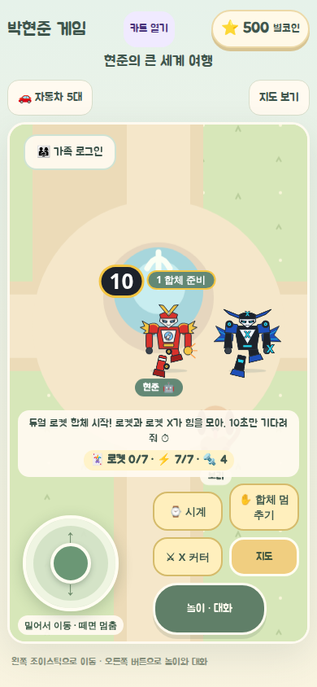
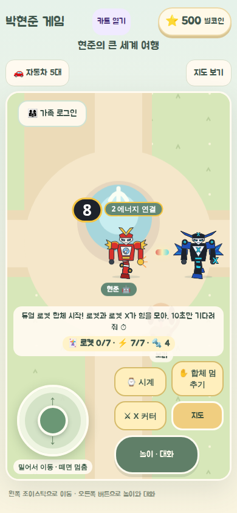
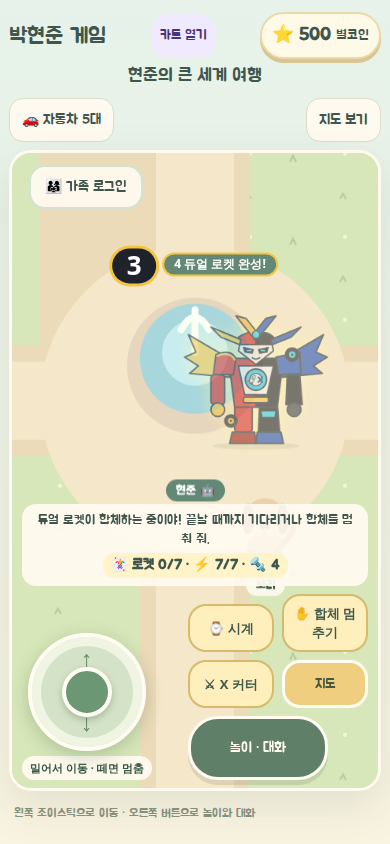
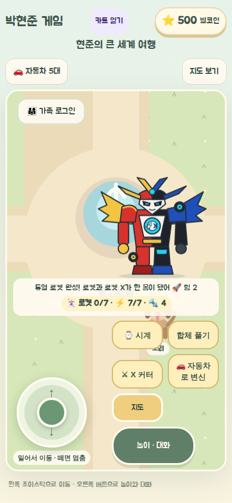
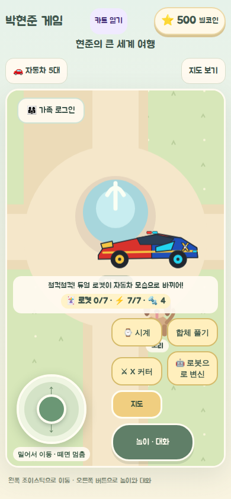

# 로켓 · 로켓 X · 듀얼 로켓 v1 (2026-11-08)

> 표기: FACT · REQUEST · PROPOSED · UNKNOWN · NOT_RUN. 작업지시서 패키지(로컬 전달본, 저장소에 넣지 않음)의 세션 S00~S06을 따른다.
> 기준: `origin/main` `e6aef0f`, 브랜치 `feat/rocket-dual-20261108`.

## 1. 요구 (REQUEST, 현준이 구술)

- 로켓과 로켓 X는 **친구인 서로 다른 로봇 두 대**다. 얼굴은 네모가 아니라 **뾰족하고 날렵하게**.
- 둘 다 **자동차로 변신**한다. 색만 다른 게 아니라 얼굴·어깨·바퀴·날개가 달라야 한다.
- 둘이 **진짜 한 몸으로 합체**하고, 합체에는 **기다리는 시간과 단계**가 있다.
- 스마트폰 터치로 조작한다.

이번 범위가 아닌 것: 티라 외형 수정, 골드·에메랄드·다이아몬드 삼총사, 로봇 미니게임, 롤러코스터(각각 별도 트랙).

## 2. 결정 (Gate B 승인, 2026-11-08 — 기본값)

| ID | 결정 | 상태 |
|---|---|---|
| Q-01 | 합체 시간 10초, 4단계(준비 0~2 · 에너지 연결 2~4 · 합체 변형 4~7 · 완성 7~10초). 상수 하나(`DUAL_FUSION_MS`) | PROPOSED, S05 체감 검사 후 재확인 |
| Q-02 | 합체 이름 「듀얼 로켓」 | PROPOSED |
| Q-03 | 두 로봇 모두 처음부터 시계에 있음(등급 0) | 결정 |
| Q-05 | 로켓+로켓 X끼리만 합체. 다른 로봇과는 합체하지 않음 | 결정 |
| Q-06 | 합체 자동차는 직접 타고 조이스틱으로 이동(기존 로봇 탑승 재사용) | 결정 |
| Q-07 | 100대 군단에 넣지 않음 | 결정 |
| Q-08 | 시안 포스터 PNG는 공개 저장소에 넣지 않음. 게임 그림은 직접 그린 SVG | 결정 |
| Q-04 | 무기는 기존 근접 무기 종류 재사용(로켓 주먹 · X 커터). 새 전투 규칙 없음 | PROPOSED |
| Q-09 | 건너뛰기 버튼 없음 | PROPOSED |
| Q-10 | 현준이 손그림이 오면 그림을 다시 맞춘다 | UNKNOWN |
| P-07 | 시계 노출: 지금은 「다른 로봇」 칸(화산·레이저 다음). 주요 6종은 그대로 | PROPOSED — Gate B 기본값에 없던 선택. 390 화면에서 로켓 X가 아래로 스크롤해야 보인다. Gate C 질문 6 |

## 3. 세션 진행

| 세션 | 내용 | 상태 |
|---|---|---|
| S00 | 읽기 전용 조사 | 완료 |
| S01 | 카드·규칙: `rb-rocket`, `rb-rocket-x`, 별도 그룹 `DuoId`, 옛 저장 공통 등급 미상속 | 완료 (PR #54) |
| S02 | 그림 6종: 로봇 2 · 자동차 2 · 듀얼 로봇 · 듀얼 자동차 | 완료 (PR #54). **Gate C 통과**: 보호자 "로켓은 마음에 듦" (2026-11-08) |
| S03 | 로켓·로켓 X 각각 robot ↔ car | 완료 |
| S04 | 합체 순수 규칙 `rocket-dual.ts` | 완료 (PR #54) |
| S05 | 시계에서 로켓 쌍 합체 → 10초 4단계 카운트다운 → 듀얼 로켓 → 듀얼 자동차 ↔ 로봇, 분리, 멈추기·이동 시 취소 | 완료 |
| S06 | 회귀·실기기·배포 판정 | 자동 검사 완료, 실기기 NOT_RUN |

### 지금 게임에서 되는 것 (FACT)

1. 시계 🃏 소환 「다른 로봇」에서 로켓 또는 로켓 X 소환 → 「🚗 자동차로 변신」 → 조이스틱으로 주행 → 「🤖 로봇으로 변신」. 자동차일 때는 무기를 쓰지 않는다.
2. 시계 💥 합체에서 로켓과 로켓 X를 고르면 다른 카드는 쉬고, 미리보기에 듀얼 로켓이 나온다 → 「💥 듀얼 로켓 합체 시작!」.
3. 월드에서 큰 숫자 카운트다운과 단계 이름이 나온다: 1 합체 준비(0~2초) · 2 에너지 연결(2~4초) · 3 합체 변형(4~7초) · 4 듀얼 로켓 완성!(7~10초). 합체 중에는 무기·변신·다시 합체가 안 되고, 「✋ 합체 멈추기」로 멈출 수 있다.
4. 10초가 지나면 듀얼 로켓 한 몸이 되고 합체 기록이 한 번 올라간다. 「🚗 자동차로 변신」으로 듀얼 로켓 카 한 대가 되어 직접 몬다.
5. 「합체 풀기」(자동차 모습에서도)를 누르면 로켓만 남고 로켓 X는 시계로 돌아간다. 카드·등급은 그대로다.
6. 합체 도중 멈추기·지도 이동·새로고침·다른 소환을 하면 합체는 기록 없이 끝난다(지도 이동과 멈추기 뒤에는 로켓만 남음).

## 4. 설계 (FACT, 코드)

| 파일 | 역할 |
|---|---|
| `src/game/robot/robot-catalog.ts` | 두 종(경찰 계열, starter). `DuoId`, `DUO_IDS`, `isDuoId`, `isRocketPair`. 티라·엠블러스용 `isRosterId`는 그대로 |
| `src/game/robot/robot-engine.ts` | 옛 시계 공통 등급 이관에서 로켓 제외. `validFusion`: 로켓은 서로하고만 합체 |
| `src/game/robot/robot-forms.ts` | 모습에 `car` 추가. `altForm`: 단독 로봇의 모습, 로켓 쌍이면 듀얼 자동차 |
| `src/game/robot/rocket-dual.ts` | 순수 상태 기계: `idle → gather → link → assemble → reveal → active`, 취소, 분리, 카운트다운. 시간은 호출하는 쪽이 넘긴다. 시계가 거꾸로 가도 되돌아가지 않는다. 저장하지 않음 |
| `src/components/hyunjun/useRobotWorld.ts` | 로켓 쌍만 `dualFusing` 단계로 갈라 200ms마다 진행. 지금 살아 있는 합체 번호(`dualLive`) 하나만 완료를 기록할 수 있고, 멈추기·회수·다른 소환·다른 합체가 그 번호를 지운다. 기존 2·3단 합체(2.2초)는 그대로 |
| `RocketDuoArt.tsx` · `rocket-duo.css` | 로봇·자동차·듀얼 그림, 합체 무대(`DualFusionStage`). 움직임 줄이기 설정이면 흔들림 없이 단계와 숫자만 바뀐다 |
| `RobotActorView.tsx` · `RobotWatch.tsx` · `Village.tsx` · `RobotWorld.tsx` | 무대·듀얼 그림 연결, 합체 탭의 로켓 쌍, 「✋ 합체 멈추기」 버튼 |

저장: 키 `hyunjun-game-v2`, version 3 그대로. 로켓 카드는 기존 `cards`에 `{uses, grade}`로 들어가고, 합체 중간·자동차 모습은 저장하지 않는다. 옛 코드로 되돌리면 모르는 카드라 로켓 카드만 사라진다(나머지 저장 유지).

## 5. 검증

| 항목 | 결과 | 근거 |
|---|---|---|
| 단위 테스트 | PASS 227/227 | `rocket-catalog.test.ts`(로켓끼리만 합체, 기록 1회·카드 유지), `rocket-dual.test.ts`(경계·중복 완료·시계 역행·취소·분리), `robot-forms.test.ts`(로켓·듀얼 자동차, 티라·엠블러스 회귀) |
| 타입·린트·문서 링크 (`npm run check`) | PASS | 린트 오류 0, 기존 경고 8 |
| `scripts/verify-rocket-dual.cjs` (360·390·태블릿 768) | PASS | 단독 자동차 2대, 합체 탭 짝 제한, 4단계 순서와 약 10초, 다시 눌러도 카운트다운 유지, 기록 1회·부품 그대로, 듀얼 자동차, 자동차에서 분리, 3초 멈추기·지도 이동·6초 새로고침 뒤 기록 없음, 가로 스크롤 없음 |
| 움직임 줄이기 (390) | PASS | 4.6초에 3단계, 흔들림 애니메이션 없음 |
| 기존 로봇·월드 브라우저 검사 | 아래 회귀 표 | |
| 독립 코드 리뷰 | 1차(Codex) 1건 수정 · 2차 NOT_RUN | 2차 Codex 리뷰는 Codex 쪽 계정 오류(402)로 실행되지 않음. 대신 직접 점검해 2건 수정: ① 멈추기·회수 직후 이미 돌던 확인 한 번이 합체를 기록할 수 있던 틈 ② 합체 중 다시 시작하면 카운트다운이 처음부터 다시 시작되던 문제 |
| 실기기·삼성 브라우저·S Pen | NOT_RUN | |

| 1 합체 준비 | 2 에너지 연결 | 3 합체 변형 | 4 완성 | 듀얼 로켓 | 듀얼 로켓 카 |
|---|---|---|---|---|---|
|  |  |  |  |  |  |

| 디자인 확인 시트 | 시계 (390) | 월드 로켓 (390) | 월드 로켓 X (390) |
|---|---|---|---|
|  |  |  |  |

### 알려진 한계

- 360×740에서 하단 안내판이 듀얼 로켓 카 아래쪽을 조금 가린다. 다른 로봇에도 있던 기존 화면 구조 문제다(roster-100 문서의 "상태 안내판 겹침").
- 듀얼 로켓의 무기는 로켓 쪽 근접 무기를 그대로 쓴다. 미사일·터보·실드(P-04)는 새 전투 규칙이라 만들지 않았다.
- 합체 탭에서 로켓 카드는 「다른 로봇」 순서 그대로 아래쪽에 있다(P-07 미답).

## 6. Gate C 결과

- 2026-11-08 보호자: "로켓은 마음에 듦" → 그림 6종 그대로 진행.
- 질문 6(카드를 시계 맨 앞으로?)은 답이 없어 지금 위치(「다른 로봇」)를 유지한다.

## 7. 세션 인계 (S03·S05·S06 자동 검사)

| 필드 | 값 |
|---|---|
| 세션 | S03 · S05 · S06(자동 검사까지) |
| 실행 일시 | 2026-11-08 |
| 담당 에이전트 | Claude Code (구현·점검). Codex 2차 리뷰는 계정 오류로 NOT_RUN |
| 기준 저장소/HEAD | `haapy-mind-life/phj-game` `e477dd1` |
| 작업 브랜치/worktree | `feat/rocket-dual-s05-20261108` / 별도 worktree |
| 승인 게이트 | Gate C — 보호자 "로켓은 마음에 듦. 합체·자동차 변신도 가능하도록 작업 진행" (2026-11-08) |
| 요구사항 ID | RD-01 ~ RD-08 |
| 수락 기준 ID | RD-AT-04~14 · 16~23 PASS(자동), RD-AT-20 실기기·RD-AT-24 현준이 체감 NOT_RUN |

- **완료:** 개별 자동차, 10초 합체와 카운트다운, 듀얼 로켓·듀얼 자동차, 분리, 멈추기·이동·새로고침 안전.
- **미완료:** 삼성 실기기·S Pen UAT, 10초가 지루한지 현준이 체감(RD-AT-24 → Q-01 재확인), 카드 위치(P-07).
- **다음 세션:** 실기기에서 §3 "지금 게임에서 되는 것" 1~6을 따라 해 보고, 10초 길이와 카드 위치를 정한다.
