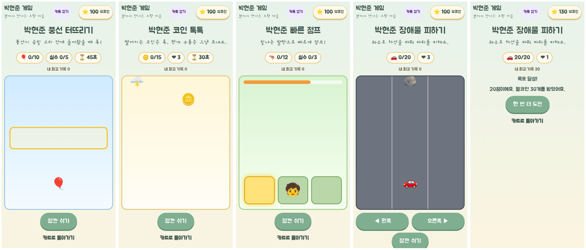

# 카트 미니게임 (아케이드) 검증 (2026-11-10)

- 대상: `/kart`의 준비 중 미니게임(mn-*)을 하나의 공통 화면 `/mini/$game`으로 구현. 큰 게임(lg-*)은 이번 범위가 아니다.
- 기준: `origin/main` `344d819`, 브랜치 `feat/minigames-20261110`.
- 공통 규칙(FACT, 코드):
  - 게임 표 하나(`src/game/play/arcade.ts`)가 경로·보상·최고 기록·카트 연결을 정한다. 새 게임은 표 한 줄 + 엔진 + 화면.
  - 저장: 키 `hyunjun-game-v2`, version 3 그대로. 새 필드 `arcadeBest`(게임별 최고 점수, 옛 저장은 0). 정산 행동 `settle-arcade`는 기존 `settledMinis` 목록으로 같은 판을 두 번 주지 않는다.
  - 보상: 점수 × 게임별 코인 + 목표 달성 보너스 10. 한 판 최대 42 별코인을 넘지 않는다(땅콩 톡톡과 같은 수준).
  - 진행: 시작 → 놀이 ⇄ 잠깐 쉬기 → 결과. 쉬는 동안·화면이 가려지면 시간이 멈춘다. 도중에 나가면 보상 없음. 한 번 더 도전, 카트로 돌아가기.
  - 두 라우터(TanStack `src/routes/mini.$game.tsx`, Pages `src/pages-entry.tsx`)가 같은 컴포넌트를 쓴다. 없는 게임 주소는 "놀이를 찾지 못했어요"와 돌아가기 링크.

## 게임 (PROPOSED 규칙: 카트 설명을 따라 정한 잠정값)

| ID | 게임 | 놀이 | 목표 · 실패 | 한 판 최대 |
|---|---|---|---|---|
| mn-02 | 풍선 터뜨리기 | 세 줄로 올라오는 풍선이 금빛 고리 안에 있을 때 톡 | 10개 · 고리 밖 실수 5번 또는 45초 | 40 |
| mn-04 | 코인 톡톡 | 떨어지는 코인 톡, 번개 구름은 그냥 보내기 | 15개 · 구름 3번 또는 30초 | 40 |
| mn-05 | 빠른 점프 | 빛나는 발판으로 점프, 성공할수록 빛이 짧아짐(2.2초 → 1.1초) | 12번 · 실수 3번 | 34 |
| mn-17 | 장애물 피하기 | 왼쪽·오른쪽 버튼으로 차선을 바꿔 바위 지나가기 | 20개 · 부딪힘 3번 | 30 |

## 검증

| 항목 | 결과 | 근거 |
|---|---|---|
| 단위 테스트 | PASS | `arcade.test.ts`(표·보상 상한·저장 정규화), `src/lib/arcade-save.test.ts`(옛 v3 저장, 한 번만 정산, 잘못된 입력 거절), `minis/minis-batch1.test.ts`(게임별 승리·패배·경계) |
| `npm run check` · `build` · `build:pages` | PASS | 린트 오류 0(기존 경고 8) |
| `scripts/verify-arcade.cjs` (360·390 터치) | PASS | 카트에서 열기, 터치로 시작해 목표까지, 보상 1회, 쉬기 중 정지, 지면 점수만큼만, 도중에 나가면 0, 가로 스크롤 없음, 없는 게임 주소 |
| 회귀 | PASS | `verify-kart-hub` · `verify-world-entry` · `verify-peanuts` |
| 실기기 | NOT_RUN | |

