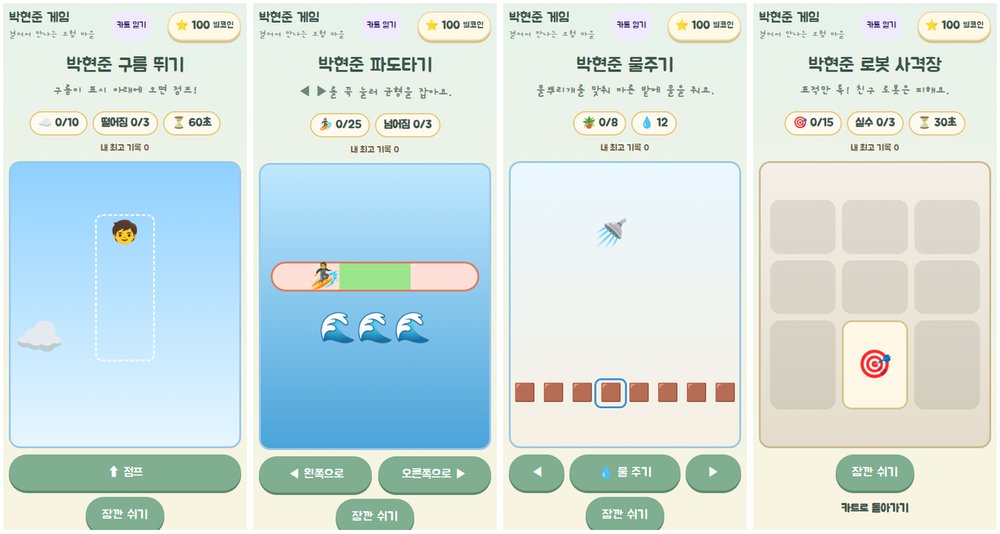
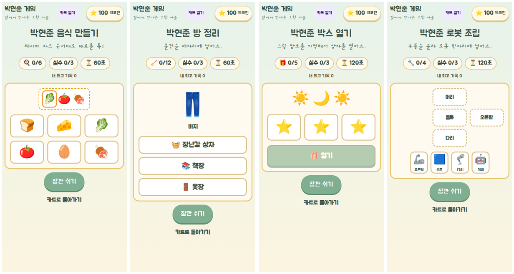
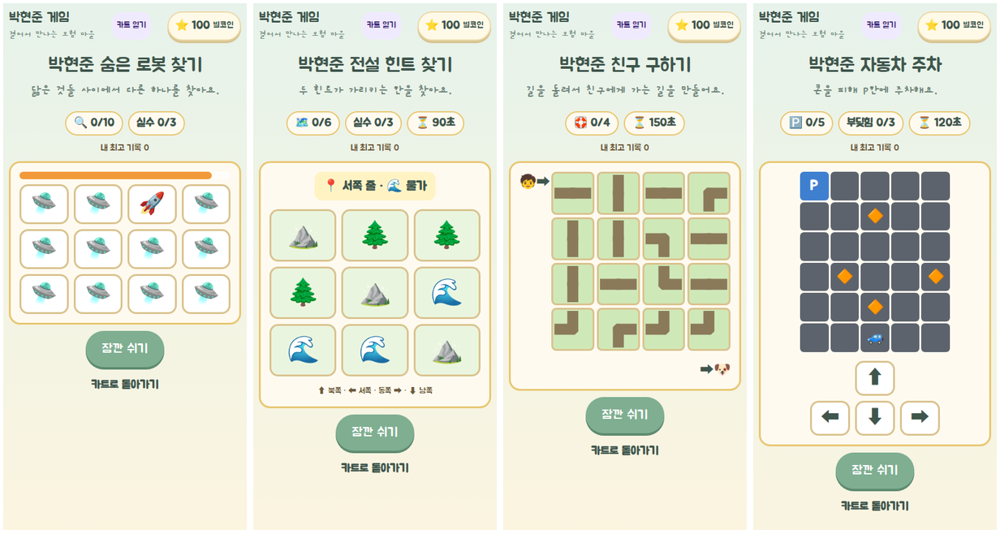
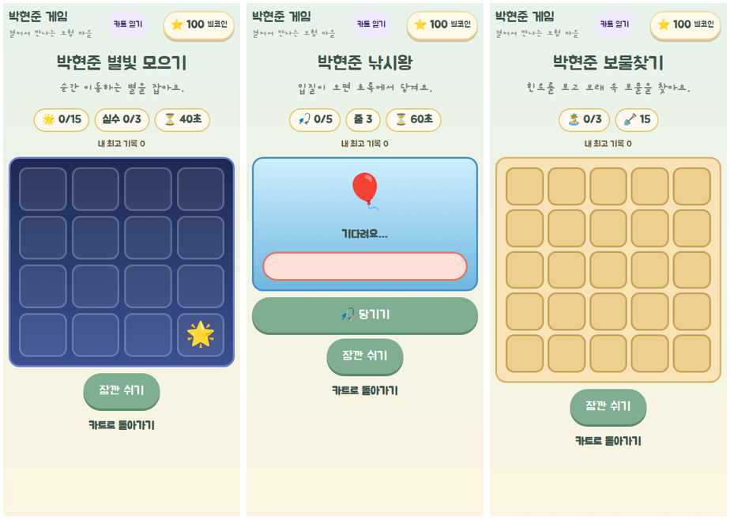

# 카트 미니게임 (아케이드) 검증 (2026-11-10)

- 대상: `/kart`의 준비 중 미니게임(mn-*)을 하나의 공통 화면 `/mini/$game`으로 구현. 큰 게임(lg-*)은 이번 범위가 아니다.
- 기준: `origin/main` `344d819`, 브랜치 `feat/minigames-20261110`.
- 공통 규칙(FACT, 코드):
  - 게임 표 하나(`src/game/play/arcade.ts`)가 경로·보상·최고 기록·카트 연결을 정한다. 새 게임은 표 한 줄 + 엔진 + 화면.
  - 저장: 키 `hyunjun-game-v2`, version 3 그대로. 새 필드 `arcadeBest`(게임별 최고 점수, 옛 저장은 0). 정산 행동 `settle-arcade`는 기존 `settledMinis` 목록으로 같은 판을 두 번 주지 않는다.
  - 보상: 점수 × 게임별 코인 + 목표 달성 보너스 10. 한 판 최대 42 별코인을 넘지 않는다(땅콩 톡톡과 같은 수준).
  - 진행: 시작 → 놀이 ⇄ 잠깐 쉬기 → 결과. 쉬는 동안·화면이 가려지면 시간이 멈춘다. 도중에 나가면 보상 없음. 한 번 더 도전, 카트로 돌아가기.
  - 두 라우터(TanStack `src/routes/mini.$game.tsx`, Pages `src/pages-entry.tsx`)가 같은 컴포넌트를 쓴다. 없는 게임 주소는 "놀이를 찾지 못했어요"와 돌아가기 링크.

## 게임 (PROPOSED 규칙: 카트 설명을 따라 정한 잠정값)

| ID | 게임 | 놀이 | 목표 · 실패 | 한 판 최대 |
|---|---|---|---|---|
| mn-02 | 풍선 터뜨리기 | 세 줄로 올라오는 풍선이 금빛 고리 안에 있을 때 톡 | 10개 · 고리 밖 실수 5번 또는 45초 | 40 |
| mn-04 | 코인 톡톡 | 떨어지는 코인 톡, 번개 구름은 그냥 보내기 | 15개 · 구름 3번 또는 30초 | 40 |
| mn-05 | 빠른 점프 | 빛나는 발판으로 점프, 성공할수록 빛이 짧아짐(2.2초 → 1.1초) | 12번 · 실수 3번 | 34 |
| mn-17 | 장애물 피하기 | 왼쪽·오른쪽 버튼으로 차선을 바꿔 바위 지나가기 | 20개 · 부딪힘 3번 | 30 |
| mn-12 | 구름 뛰기 | 흘러가는 구름이 가운데 표시 아래 올 때 「점프」. 성공할수록 구름이 빨라짐 | 10번 착지 · 빈 하늘 점프 3번 또는 60초 | 40 |
| mn-13 | 파도타기 | 파도와 긴 너울이 바늘을 밀고, ◀ ▶를 꾹 눌러 초록 구역에 머무르면 1초에 1점. 가만히 있으면 반드시 넘어진다 | 25점 · 끝에 3번 닿기 | 35 |
| mn-11 | 물주기 | ◀ ▶로 물뿌리개를 돌려 「물 주기」. 3초마다 바람이 한 칸 밀어 냄 | 마른 밭 8칸 · 물 12번을 다 쓰면 끝 | 42 |
| mn-20 | 로봇 사격장 | 3×3 칸에 뜨는 표적만 톡(안전한 에너지탄), 친구 로봇 표지는 피하기. 로봇 카드·부품과 무관 | 30초에 15개 · 친구 3번 | 40 |
| mn-14 | 음식 만들기 | 레시피 카드 순서대로 재료 톡(틀려도 진행은 유지). 요리할수록 카드가 3 → 5개로 길어짐 | 60초에 요리 6개 · 틀린 재료 3번 | 40 |
| mn-15 | 방 정리 | 나온 물건(장난감·책·옷)을 장난감 상자·책장·옷장 중 맞는 곳에 톡 | 60초에 12개 · 틀린 곳 3번 | 34 |
| mn-18 | 박스 열기 | 그림 암호 3개가 2.5초 보였다 숨으면 다이얼을 맞춰 「열기」. 틀리면 암호가 다시 보임. 상자마다 같은 보상, 뽑기 없음 | 상자 5개 · 틀리기 3번 또는 120초 | 40 |
| mn-09 | 로봇 조립 | 부품을 고른 뒤 로봇 그림의 빈자리를 톡. 처음 2대는 부품 4개, 다음 2대는 5개. 로봇 카드·부품과 무관 | 로봇 4대 · 틀린 자리 3번 또는 120초 | 42 |
| mn-03 | 숨은 로봇 찾기 | 닮은 그림 12개(🤖/👾, 🚓/🚑 등) 중 다른 하나를 라운드당 8초 안에 톡 | 10라운드 · 틀리거나 시간 초과 3번 | 40 |
| mn-10 | 전설 힌트 찾기 | 3×3 지도(숲·물가·산)에서 줄 힌트 + 땅 힌트가 가리키는 단 하나의 칸 찾기. 실제 전설 찾기와 무관 | 6번 · 틀리기 3번 또는 90초 | 40 |
| mn-16 | 친구 구하기 | 4×4 길 조각을 눌러 돌려 현준이(왼쪽 위)와 친구(오른쪽 아래)를 잇기. 모든 판은 실제 길에서 만들어 반드시 풀림 | 4판 · 150초(실수 없음) | 42 |
| mn-19 | 자동차 주차 | 5×6 주차장에서 화살표로 한 칸씩, 콘에 부딪히면 그 자리. 모든 주차장은 P까지 5칸 이상 빈 길이 있음 | 5곳 · 부딪힘 3번 또는 120초 | 40 |
| mn-01 | 별빛 모으기 | 4×4 밤하늘에서 순간 이동하는 별을 사라지기 전에 톡(머무는 시간 1.5초 → 0.8초). 마을 별빛 공원과 다른 규칙 | 40초에 15개 · 빈 하늘 3번 | 40 |
| mn-06 | 낚시왕 | 입질이 오면 움직이는 바늘이 초록일 때 「당기기」. 너무 일찍·초록 밖은 줄 끊김, 놓친 입질은 도망 | 5마리 · 줄 3번 또는 60초 | 40 |
| mn-07 | 보물찾기 | 5×5 모래 파기, 거리 힌트(🔥 바로 옆·🌤️ 두 칸·❄️ 더 멀리). 시계 없음 | 보물 3개 · 삽질 15번 | 40 |

## 검증

| 항목 | 결과 | 근거 |
|---|---|---|
| 단위 테스트 | PASS | `arcade.test.ts`(표·보상 상한·저장 정규화), `src/lib/arcade-save.test.ts`(옛 v3 저장, 한 번만 정산, 잘못된 입력 거절), `minis/minis-batch1.test.ts`(게임별 승리·패배·경계) |
| `npm run check` · `build` · `build:pages` | PASS | 린트 오류 0(기존 경고 8) |
| `scripts/verify-arcade.cjs` (360·390 터치) | PASS | 카트에서 열기, 터치로 시작해 목표까지, 보상 1회, 쉬기 중 정지, 지면 점수만큼만, 도중에 나가면 0, 가로 스크롤 없음, 없는 게임 주소 |
| 회귀 | PASS | `verify-kart-hub` · `verify-world-entry` · `verify-peanuts` |
| 실기기 | NOT_RUN | |

5회차 회귀 검사(kart-hub·world-entry·peanuts)는 사용 한도로 NOT_RUN.

## 남은 계획

남은 미니게임 11개의 회차와 잠정 규칙은 [다음 작업 계획](../../superpowers/plans/2026-11-11-next-actions.md) §2에 있다.
