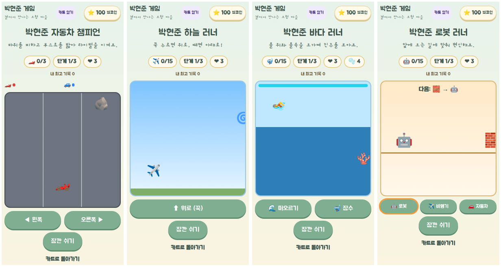

# 카트 큰 게임 검증 (2026-11-12~)

- 대상: `/kart`의 준비 중 큰 게임(lg-*) 15개를 미니게임과 같은 공통 화면 `/mini/$game`으로 구현. 공통 규칙은 [미니게임 검증](../2026-11-10-arcade/README.md)과 같다(게임 표 `src/game/play/arcade.ts`, 저장 `arcadeBest`, 정산 `settle-arcade`, 한 판 최대 42 별코인, 쉬기·도중 이탈 무보상).
- 기준: `origin/main` `c5631d5`(PR #57), 브랜치 `feat/large-games-20261112`. 계획: [다음 작업 계획](../../superpowers/plans/2026-11-11-next-actions.md) §2.
- 큰 게임만의 규칙: **3단계(스테이지)**. HUD에 "단계 N/3", 화면 `data-stage`. 단계마다 빨라지거나 새 장애물이 나온다. 엔진은 `src/game/play/large/`.
- 하우스(lg-07)는 기존 가구 꾸미기 연결 그대로다.

## 게임 (PROPOSED 규칙: 카트 설명을 따라 정한 잠정값)

| ID | 게임 | 놀이 | 3단계 | 목표 · 실패 | 한 판 최대 |
|---|---|---|---|---|---|
| lg-14 | 자동차 챔피언 | ◀ ▶로 차선 바꾸기. 🪨 바위에 부딪히면 1초 동안 반 속도, ⚡ 부스트는 1.5초 1.6배. 라이벌은 안 부딪히고 달리는 차보다 조금 느려서 잘 피하면 반드시 이김 | 코스 1·2·3, 라이벌이 단계마다 조금씩 빨라짐 | 3코스 우승 · 라이벌이 먼저 결승 또는 부딪힘 3번 | 40 |
| lg-15 | 하늘 러너 | 「위로」를 꾹 누르면 상승, 떼면 하강. ⭕ 고리 통과, 🌀 상승기류 | 2단계부터 🐦 새, 단계마다 빨라짐 | 고리 15개(단계마다 5) · 땅·새에 부딪힘 3번 | 40 |
| lg-16 | 바다 러너 | 「잠수」·「떠오르기」로 물 위/물속 길 바꾸기. 🦪 진주는 물속에만, 물속에서는 숨(4초)이 줄어듦. 장애물 사이에는 늘 틈이 있어 한쪽 길은 열려 있음 | 단계마다 빨라짐 | 진주 15개(단계마다 5) · 부딪힘·숨 부족 3번 | 40 |
| lg-17 | 로봇 러너 | 🧱 벽은 로봇, 🕳️ 구멍은 비행기, 🚇 낮은 터널은 자동차로 변신. 다음 길을 화면 위에 알려 줌. 시계 속 로봇 카드와 무관 | 단계마다 빨라짐 | 15번 통과(단계마다 5) · 틀린 모습 3번 | 40 |

## 검증

| 항목 | 결과 | 근거 |
|---|---|---|
| 단위 테스트 | PASS | `src/game/play/large/large-batch6.test.ts`: 자동 플레이어로 3단계 모두 거쳐 승리(자동차 챔피언 30개 시드, 나머지 여러 시드), 가만히 두면 패배, 바다 장애물 간격, 잘못된 입력 |
| `npm run check` · `build` · `build:pages` | PASS | 린트 오류 0(기존 경고 8) |
| `scripts/verify-arcade.cjs` (360·390 터치) | PASS | 카트에서 열기, 터치로 3단계 승리, 보상 1회, 쉬기 중 정지, 지면 점수만큼만, 도중에 나가면 0, 가로 스크롤 없음 |
| 360×740 버튼 위치 | PASS | 모든 게임(미니 포함)의 조작 버튼이 화면 안. 이를 위해 놀이판 높이를 58vh → 44vh로 줄임 |
| 실기기 | NOT_RUN | |

### 이번에 바로잡은 것

- 자동차 챔피언: 처음 규칙(라이벌이 부스트 없는 차보다 빠름)은 부스트가 몇 개 나오느냐에 승패가 달려 운이 컸다 → 코스 40 → 30, 라이벌은 안 부딪힌 차보다 조금 느리게, 바위는 1초 감속. 자동 플레이어가 30개 시드를 모두 이김.
- 바다 러너: 물 위·물속에 장애물이 동시에 와서 피할 수 없는 순간, 그리고 그걸 막으려다 생긴 "물 위 장애물 줄줄이"(숨이 모자람) → 장애물 사이 간격을 강제하고, 너무 가까운 자리는 진주로 바꿈.

