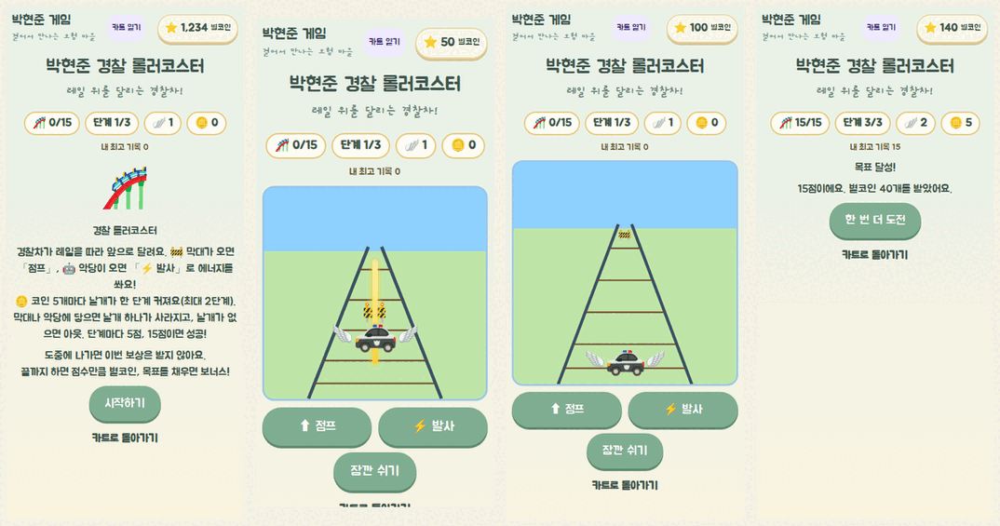

# 경찰 롤러코스터 검증 (2026-11-15)

- 요청: 보호자 "박현준 롤러 코스터 없음. 만들어줘"(2026-11-15). 그래서 B5(D-6)를 **롤러코스터를 카트 목록에 추가**로 결정했다. 카트 목록은 41개(큰 게임 21 + 미니게임 20)가 된다.
- 구현: 큰 게임 `lg-21` 「박현준 경찰 롤러코스터」(`coaster`). 다른 큰 게임과 같은 공통 화면 `/mini/$game`에서 돌아간다. 엔진은 `src/game/play/large/coaster.ts`, 테스트는 `coaster.test.ts`다. 공통 규칙은 [미니게임 검증](../2026-11-10-arcade/README.md)과 같다. 쉬는 동안 멈추고, 도중에 나가면 보상이 없으며, 한 판 보상은 한 번만 정산한다.
- 월드: 그동안 준비 중이던 「경찰 롤러코스터」 장소(2240, 160)가 이 게임을 연다. 위치는 그대로다.
- 원래 요청([블루카비·황금 칼드케이트 문서 §3](../../robot-fusion/2026-11-08-blue-gold/README.md))에서 가져온 것: 앞을 보며 레일을 돈다, 작은 돌출 날개, 코인으로 날개 업그레이드, 장애물에 닿으면 아웃, 악당에게 에너지 발사.

## 규칙 (PROPOSED)

| 항목 | 내용 |
|---|---|
| 놀이 | 경찰차가 레일을 따라 앞으로 달리고, 물건이 멀리서 다가온다. 🚧 막대는 「⬆ 점프」로 넘으면 1점. 🤖 악당은 다가오기 전에 「⚡ 발사」로 에너지를 맞히면 1점이다. 발사는 0.5초마다 한 번, 화면 아래쪽 80% 안의 가장 가까운 악당을 맞힌다 |
| 코인 · 날개 | 🪙 낮은 코인은 레일 위에서, 높은 코인은 점프해서 줍는다. 코인 5개마다 날개가 한 단계 커진다(처음 1단계, 최대 2단계) |
| 아웃 | 막대나 악당에 닿으면 날개가 한 단계 줄어든다. 날개가 없을 때 닿으면 아웃(실패) |
| 3단계 | 5점마다 다음 단계. 레일이 빨라지고 악당이 더 자주 나온다. 막대와 막대 사이는 늘 점프 한 번보다 길다(테스트로 확인) |
| 목표 · 보상 | 15점이면 성공. 점수 × 2 + 완주 보너스 10 = 한 판 최대 40 별코인 |
| 바뀌지 않은 것 | 로봇 카드·등급·부품, 저장 형식(v3), 다른 게임 |

## 검증

| 항목 | 결과 | 근거 |
|---|---|---|
| 단위 테스트 | PASS | 전체 318개. 롤러코스터 6개: 점프, 발사 사거리와 충전, 코인과 날개, 단계와 보상, 생성 간격과 같은 시드 재현, 잘못된 입력 |
| 목록 · 월드 입구 단위 테스트 | PASS | `kart-catalog.test.ts` 41개(큰 21), `adventure.test.ts` 준비 중 장소 5개 + 열린 입구 7개 |
| `npm run check` · `npm run build` · `npm run build:pages` | PASS | 오류 0, `routeTree.gen.ts` 변화 없음 |
| `verify-arcade` (`PHJ_ARCADE=coaster`) | PASS 7/7 | 터치로 15점 성공, 40 별코인 1회 지급, 쉬는 동안 정지, 지면 점수만큼만 정산, 도중에 나가면 0, 360·390 폭에서 가로 스크롤 없음. 첫 실행에서 390 폭 페이지 열기가 한 번 시간 초과(networkidle)됐고, 다시 돌리니 통과 |
| `verify-arcade` 전체 | PASS 211/211 | 게임 35개 × 360·390, 없는 게임 주소 |
| `verify-world-entry` | PASS | 롤러코스터 입구가 「경찰 롤러코스터 · 시작」으로 보이고, 누르면 `#/mini/coaster`가 열림(360·390·1280) |
| `verify-kart-hub` · `verify-peanuts` · `verify-living-world` | PASS | 카트 목록 41개 |
| 실기기(삼성 브라우저·S Pen) | NOT_RUN | |
