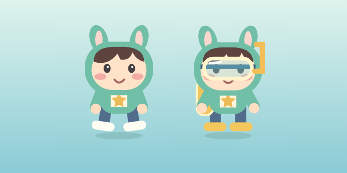
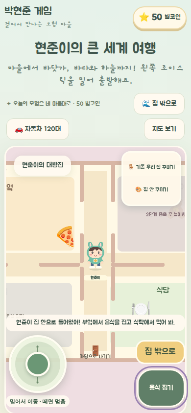
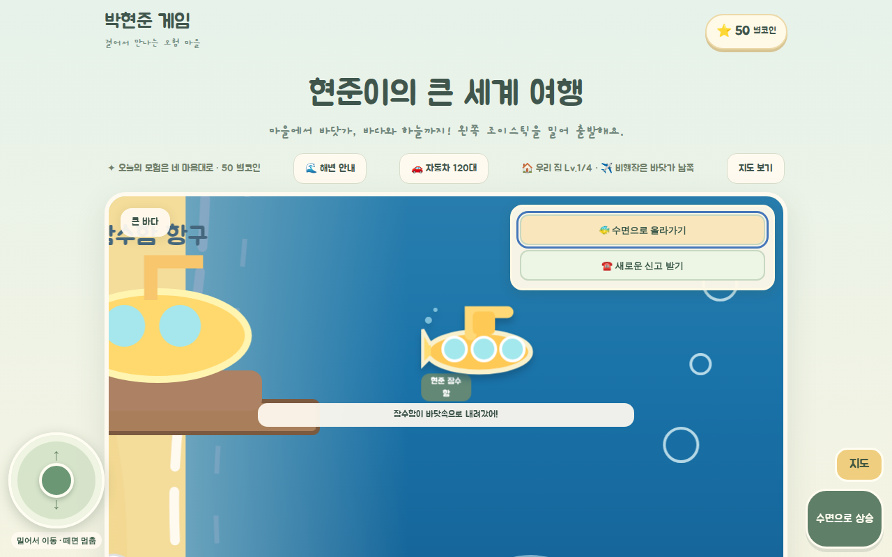

# 장면별 캐릭터 완성도와 움직임 수정 · 2026-10-18

- 실내의 얼굴·사각 몸통 그림과 잠수 고글 이모지를 기존 마을 캐릭터 기반 전신 그림으로 통일했다. 의상 색상, 손발·신발, 표정과 이름표를 유지한다.
- 걸을 때 팔·다리를 교차 움직이고, 잠수복에는 고글·호흡관·공기통·오리발을 표시한다. 이동을 멈추면 팔다리 동작이 멈추고 눈 깜빡임만 남는다.
- 아빠 로봇의 팔·다리·손발과 표정을 완성하고, 동행 중 마을에서 사라지던 표시를 복구했다. 친구와 푸드트럭 손님도 전신으로 표시한다. 잠수함 이동에는 기포 효과를 추가했다.
- 잠수 중 해변 안내·지도 이동·집 진입 시 잠수 상태를 해제해 이후 이동이 호수 안으로 되돌아가지 않도록 했다.
- 동작 줄이기 설정을 적용한다. SVG 이미지 내부 애니메이션도 설정 변경 시 명시적으로 중지한다.

검증: 단위 테스트 65개, 타입 검사, 변경 파일 ESLint, Pages 빌드 통과. Headless Chromium 1280×800 및 390×844에서 실내·잠수 전신, 이동/정지, SVG 애니메이션 프레임 변화와 동작 줄이기, 로봇 동행, 바다 탑승·잠항·이동을 확인했다. 브라우저 오류 없음. 실제 기기 터치/S Pen UAT·배포는 별도다.

