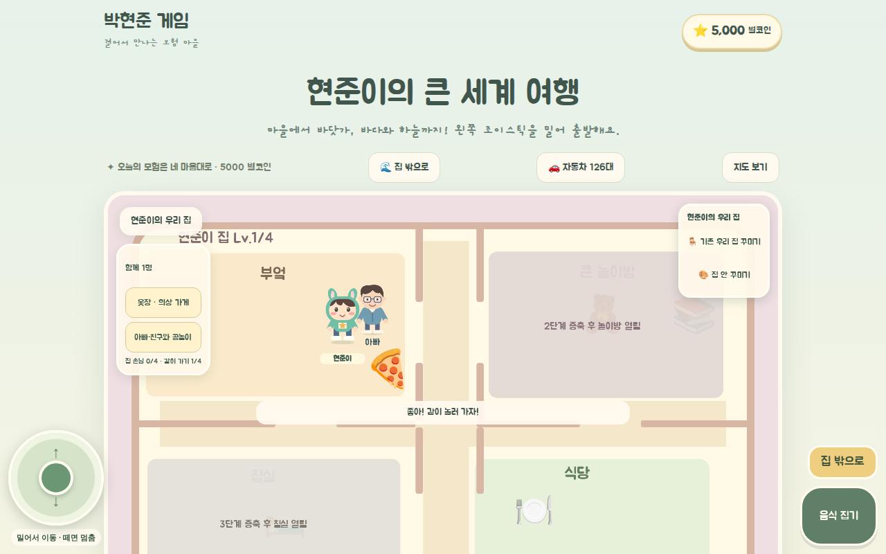
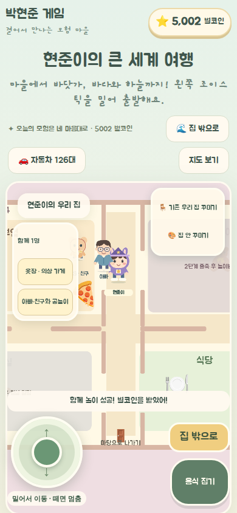
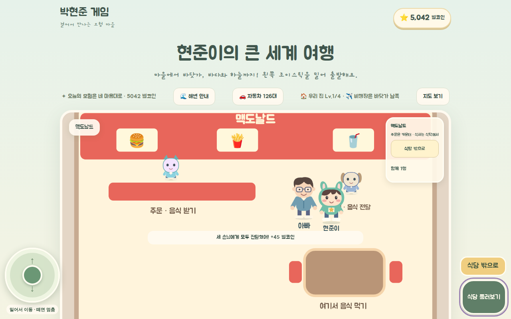
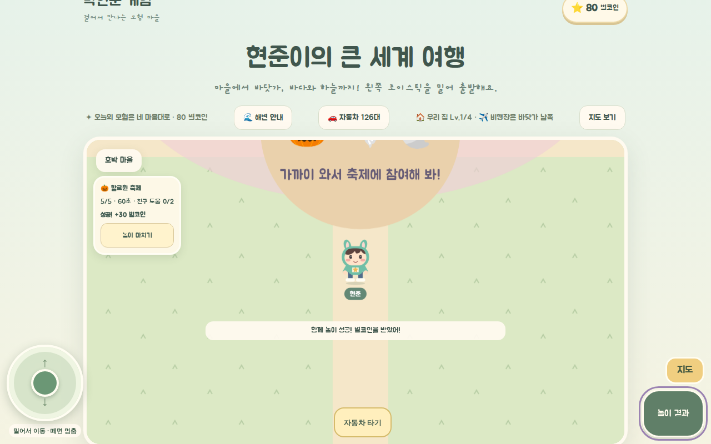
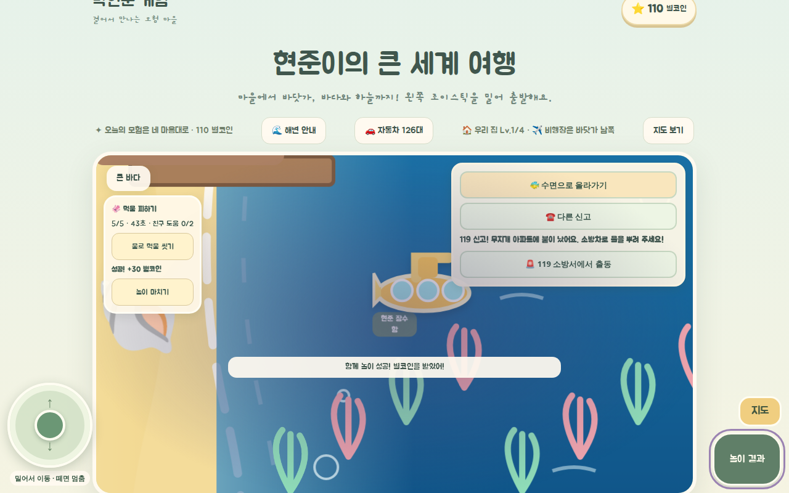

# 가족·친구와 순환형 월드 — 구현 및 검증

기준: 2026-10-18 `note.md`와 사용자 확정 답변. 사람 아빠와 로봇은 별도이며, 동행·초대·협동 놀이를 제공한다. 월드는 끝이 이어지는 구조, 총 30마을·6식당, 할로윈은 한국 시간 10월 한정이다. **‘천백까지’의 의미는 미확정으로 유지한다.**

## 구현

| 요구사항 | 반영 |
|---|---|
| 캐릭터·가족 | 사람 아빠, 별도 로봇, 30마을 친구. 인물별 고정 ID와 단일 역할. 동행·초대 각각 최대 4명. 집 안팎·식당·게임 복귀에서 유지. |
| 큰 월드 | 20,400×10,800, 기존 월드의 12배 면적. 기존 장소 좌표·ID 유지. 동서·남북 순환, 경계 카메라와 거리 판정 통일. 화면 주변만 지형·인물 표시. |
| 마을 | 기존 10마을 + 벚꽃·무지개·햄버거·바람·구름 등 20마을. 친구가 안전한 경로를 돌아다니고 집에 초대하거나 함께 이동 가능. |
| 식당 | 맥도날드·별빛 피자·바삭 치킨·친구 분식·구름 카페·행복 식당. 걸어서 입장, 메뉴 주문·수령·식사·퇴장. 메뉴 3·5·8코인, 손님 3건 전달 아르바이트 45코인. |
| 함께 놀기 | 집에서 공 주고받기, 보물·축제 수집 도움. 동료도 대상까지 이동하며 회차당 최대 2개, 8초 간격으로 돕는다. 플레이어 참여 없이 자동 완료하지 않는다. |
| 할로윈 | 호박 마을·마을 광장·해변 축제에서 사탕·보물 찾기. 기존 집 파티도 같은 10월 규칙. 기간 밖에는 중지하며 구매 물품과 첫 완료 이력 보존. |
| 바다 | 기존 해안·항구·발견 장소 유지, 남북으로 이어지는 해역과 동쪽 항구. 60초 먹물 피하기·씻기·조개 수집, 완료 30코인. 먹물 효과는 최대 2초. |
| 구매·성장 | 기존 120차량·무료 의상 보존. 의상 6종(20~80코인), 특별 도색 차량 6종(100~200코인) 추가. 집 증축 100·350·850코인 유지. |
| 기존 놀이 | 농장·러너·별자리·낚시·구조·차량·비행기·집 꾸미기 보존. 기존 입구가 NPC 대화에 가려지지 않게 우선순위 적용. |

## 경제와 저장

- 미니게임 완료 추가 10코인, 러너 완주 추가 20코인, 농장 수확 판매액 1.5배. 집 공놀이 20, 축제 30, 바다 놀이 30, 식당 아르바이트 45코인.
- 성장 시간은 **초보 혼합 플레이의 설계 목표**다. 보물 놀이 1회당 34코인을 기준으로 첫 증축은 2회, 최고 집은 37회에 가능함을 모델 테스트로 검증했다. 회차 이동·놀이 약 1분과 첫 안내를 가정하면 약 3분·38분이다. 실제 아동 플레이 시간 측정은 별도이며 강제 대기·기존 고수입 경로 제한은 없다.
- `GameState.version=2` 유지. `companions`, `guests`, `ownedOutfits`, `ownedCars`, `settledActivities`를 추가하고 구 저장은 기본 소유권을 복원한다. 인물 위치는 매 프레임 저장하지 않는다.
- 보상은 회차 ID로 중복 지급 방지, 구매는 잔액·소유권을 함께 갱신한다. 기존 세이브 키와 차량 선택 키를 유지한다.

## 검증

최종 로컬 결과: 단위 테스트 **80/80 PASS**, TypeScript PASS, 전체 ESLint **오류 0 / 기존 경고 8**, Pages 빌드 PASS, 브라우저 6시나리오 PASS.

경계 지역의 가시 영역 렌더링을 적용해 DOM 노드를 3,780개에서 1,137개로 줄였다. 1280×800 headless Chromium 최종 단독 측정에서 프레임 간격 95백분위는 **45ms**였다. 병렬 검사 중 측정은 33~63ms로 변동했으므로 실제 기기의 FPS 통과 증거로 사용하지 않는다. CODE / 로컬 자동 검증 / CI / 배포 / 실제 기기를 구분한다.

- 순환 좌표·해안 충돌·초대/동행 정원·단일 역할·구 저장·구매/보상 중복 방지·월 경계·집/식당 동선·협동 동작을 단위 테스트한다.
- 브라우저에서 아빠 실외 동행, 친구 초대, 주문·식사·3건 배달, 집 놀이, 의상·차량 구매, 기존 미니게임 입구, 축제·먹물 놀이, 양축 순환, 6식당 방문·주문을 검증한다.
- 390×844 / 1280×800, 두 손가락 이동+행동, 개별 손가락 떼기, 펜 입력·취소, 키보드 입력 초점과 가로 넘침을 검증한다.
- 11월에는 야외 축제 진입과 집 파티 진행이 차단되고, 장식과 완료 이력은 유지되는 것을 확인한다.
- 전체 브랜치 별도 리뷰 1회 수행. 지형 레이어, 기존 해안 SVG 배율, 활동 표시 순서, 실내 목표 위치, 기존 입구 우선순위의 지적 사항을 회귀 테스트와 함께 수정했다.
- CI·배포·실제 삼성 브라우저/S Pen·현준이 직접 UAT: **NOT RUN**.

브라우저 검증 재실행: Pages preview를 실행하고 `PLAYWRIGHT_CORE_PATH`, `CHROMIUM_EXECUTABLE`, 필요시 `PHJ_PREVIEW_URL`을 지정해 `node scripts/verify-living-world.cjs`를 실행한다. `family`, `explore`, `input`, `season`, `restaurants`, `seams` 중 하나를 인수로 주면 해당 시나리오만 실행한다. 테스트 브라우저는 독립 저장 공간을 사용하며 구매 검증에는 fixture 화폐를 사용한다.

