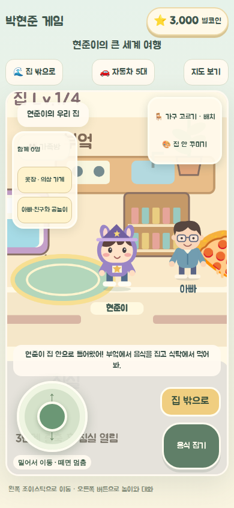
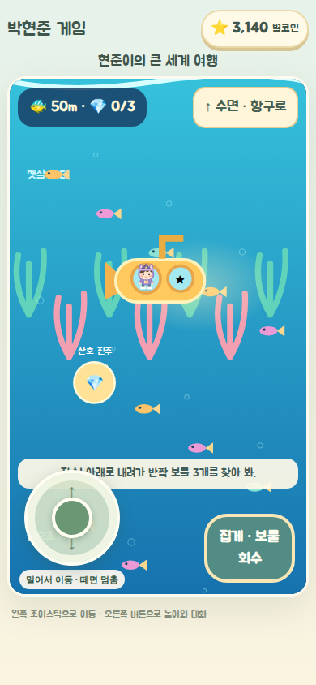
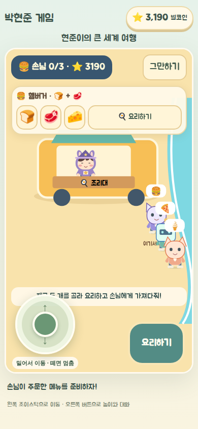

# 현준이의 장소 놀이와 성장 개선

대상은 7살 어린이. 직접 장소를 찾아 짧게 놀고 자동차와 집이 좋아지는 흐름으로 개선했다.

- 출동: 자동 신고와 상시 출동판을 없앴다. 배달 차고·경찰서·소방서·응급센터에서 출발하고, 이동하며 세 목표를 해결한다. 기본 목표에는 시간 제한이 없고 90초 이내 완료만 추가 보상한다.
- 자동차: 기본 차 한 대로 시작한다. 경찰차 120, 소방차 200, 구급차 280, 푸드트럭 360코인 순으로 구입한다. 엔진 강화 60코인은 모든 프레임 속도에서 실제 주행 속도를 15% 높인다. 전용 강화 100코인은 배달 보상 20%, 단서 방향 표시, 물 분사 범위 50%, 두 명 동시 구조, 음식 두 개 준비 중 해당 기능을 연다.
- 저장: 모델 버전 3. 기존 저장 키를 유지한다. 무료 차량은 기본 차로 정리하고 유료 도색 차량은 종류별 정가를 한 번만 환급한다. 돈·집·가구·옷·가족 진행은 보존한다.
- 잠수함: 항구에서 탑승하면 별도 세로 해저 화면으로 전환한다. 물고기·산호·동굴을 지나 보물 3개를 회수하고 먹물을 씻는다. 현재 복장의 현준이가 창문에 보이며, 귀항하면 출발 위치와 차량 탑승 상태를 복구한다. 탐험 중 월드 입력과 활동 시계는 정지한다.
- 집: 월드·집·식당·장사에 같은 캐릭터 렌더러를 사용한다. 실내 카메라를 확대하고 주방·소파·식탁과 저장된 가구 배치를 실제 집에 그린다. 가구는 정해진 안전한 자리에 배치된다. 확장하면 놀이방·침실·파티 장식이 열린다.
- 해변: 전신 손님 여섯 명이 산책한다. 장사는 주문 그림에 맞는 재료 두 개 선택 → 조리 → 손님에게 이동 → 전달 순서다. 트럭 구매 전에는 도우미로 연습하고 구매 후에는 자기 트럭의 판매자로 일한다. 한 회차 손님은 세 명이며, 판매마다 10코인과 완료 보상을 지급한다. 중단해도 이미 번 판매 수입은 유지한다.

## 확인 방법

`npm test`, `npm run lint`, `node_modules/.bin/tsc --noEmit`, `npm run build:pages`.

브라우저 검증은 `scripts/verify-child-play.cjs`를 사용한다. 설치된 도구 위치를 `PLAYWRIGHT_CORE_PATH`, `CHROMIUM_EXECUTABLE`로 지정하고, 필요하면 `PHJ_PREVIEW_URL`, `PHJ_EVIDENCE_DIR`을 설정한다. 테스트는 독립된 브라우저 저장을 사용한다.

기존 기능 회귀는 `scripts/verify-living-world.cjs`의 가족·식당·계절·입력·월드 경계 시나리오로 확인한다. 스크린샷은 아래에 기록한다.

실제 아이와 모바일 기기에서의 사용성 검증은 별도로 필요하다. 이번 변경은 push·merge·배포를 수행하지 않는다.

## 자동 검증 결과

- 원래 개선 기능의 단위 테스트 91개 통과. 추가 통합 변경을 포함한 `6f97447` 기준 분리 작업 공간에서는 96개 통과. 타입 검사 및 Pages 빌드 성공. 린트 오류 0개, 기존 Fast Refresh 경고 8개.
- 새 성장·놀이 경로 전체와 재접속 잔액 유지 검증 통과.
- 휴대폰에서 집 입장 후 브라우저의 자동 스크롤이 카메라를 밀던 문제를 수정했다. 게임 영역을 스크롤되지 않는 클리핑 영역으로 바꾸고 입장 후 내부 스크롤 0 및 캐릭터 중앙 배치를 검증한다.
- 기존 가족 동행·초대·의상·집 놀이, 식당 6곳, 야외 축제, 11월 이벤트 제한, 멀티터치·펜 취소, 월드 양쪽 경계 검증 통과.
- 임무 표시 SVG를 화면 주변으로 제한해 과도한 그리기 면적을 방지했다. 마지막 경계 시나리오의 headless 프레임 간격 p95는 44~51ms였다. 실제 기기 성능 보장은 아니다.

### 화면 증거

차고와 임무 화면은 `images/16-garage-phone.png`, `images/16-station-tablet.png`에 기록했다.
