# 현준이 요청 반영 — 섬·나라, 바닷속 비행기, 큰 맥도날드, 아빠 회사, 이사 (2026-10-25)

## 원문 (음성 전사 그대로)

> 자, 이제 이제 맥도날드가 맥도날드 친구들도 좀 맥도날드 맥도날드 사람들도 좀 많게 만들어주고 맥도날드도 좀 있어야 되고 커야 돼, 커, 커, 커, 커. 안 크면 이제 팔 수가 없잖아. 그리고 이제 아빠 회사도 또 만들어주고 맥도날드도 좀 만들어주고 뭐도 좀 만들어줘, 많이. 그리고 그리고 어 그리고 그리고. 그리고 이제 우리 집도 더 넓게 해주고 우리 집 이사도 할 수 있게 해줘. 그리고 그리고 이제 뭐 공사장도 만들고 많이 뭐 비행기가 바다 위에는 못 날아. 그러니까 바다 밑으로 날 수 있게 해줘. 바다한테. 바다 위에도 날 수 있게 해줘. 그리고 알아서 이제 바다가 없어져도 그냥 쭉 가는 거야. 쭉. 쭉 가는 거야 바다가 없어도. 그리고 바다 없어도 쭉 갈 수 있게 해줘. 그리고 나는 잠수함이 좀 커야 된다 해야나? 그래도 좀 길게 해줘. 승객들도 좀 타게 해주고 승객들도 타게 해주고 뭐 제주도 일본 뭐 나라랑 섬도 많이 만들어줘. 독도 이런 거. 독도 이런 거 섬이나 나라 같은 거도 많이 만들어줘. 알았지?

## 해석과 반영

| 요청 | 반영 | 상태 |
|---|---|---|
| 맥도날드 사람 많게 | 맥도날드 바깥에 손님 6명, 안에 직원 2명 추가 + 의자에 앉은 손님 3명 | 반영 |
| 맥도날드 크게 ("안 크면 팔 수가 없잖아") | 맥도날드 건물·충돌 영역 1.6배. 실내 방 크기는 모든 식당이 같은 방을 써서 그대로 두고, 사람을 늘림 | 반영 (실내 넓히기는 OPEN) |
| 맥도날드 더 만들어줘 | 맥도날드 시티점(x4700,y2350), 바닷가점(x13200,y1700) 추가. 기존 맥도날드는 그대로. 식당 총 8곳 | 반영 |
| 아빠 회사 | 원래 마을 남쪽 띠(y≈2250)에 높은 `아빠 회사` 건물. 앞에서 행동 → 아빠 응원 대사 | 반영 |
| "뭐도 좀 만들어줘, 많이" | 별빛 마트, 햇살 학교, 장난감 가게, 튼튼 병원, 꿈 도서관 | 반영 (무엇을 원하는지 OPEN) |
| 우리 집 더 넓게 | 집 5단계 `엄청 넓은 궁전`(1500 별코인). 실내 동쪽에 궁전 날개(수영장·미끄럼틀)가 열림 | 반영 |
| 이사 | 집터 4곳(원래 동네·새 동네·제주도·동쪽 바닷가). 빈 집터에서 `여기로 이사하기`. 무료이고, 집 레벨·가구·마당 장식이 함께 옮겨짐 | 반영 |
| 공사장 | 공사장 x5600,y2250. `공사 돕기`를 누를 때마다 한 층씩 올라가서 5층이 되면 완성, 다시 누르면 새로 공사 | 반영 |
| 비행기가 바다 위에 못 남 | 코드에서는 원래 날 수 있었음(헤드리스로 확인). 다만 바다 위에서 버튼이 `하늘 비행 중`으로 막혀 보였고, 누르면 "착륙할 수 없어"라는 말만 나왔음. 이제는 바다 위에서 버튼이 `바닷속으로 슝` / `하늘로 슝`으로 바뀜 | 반영 |
| 바다 밑으로 날기 | 바닷속 모드: 화면이 파랗게 바뀌고 물고기·거품이 보임. 섬 위에서는 잠수할 수 없음 | 반영 |
| 바다가 없어도 쭉 | 바닷속에서 바다가 끝나면 자동으로 물 밖으로 나와 계속 비행함. 멈추거나 되돌아가지 않음 | 반영 ("자동으로 앞으로 가기"인지는 OPEN) |
| 잠수함 길게 | 세로 잠수 화면의 잠수함 길이를 약 2배로 | 반영 |
| 승객 태우기 | 승객 창문 4개. 동행 중인 가족·친구가 먼저 타고, 남는 자리는 친구 승객이 탐. 상단에 `승객 4명` 표시 | 반영 (승객을 태워 나르는 놀이인지는 OPEN) |
| 제주도·일본·독도, 섬과 나라 많이 | 독도, 울릉도, 제주도, 일본, 하와이 섬, 보물섬을 바다 띠(x7380..10200)의 남북으로 배치. 걸어 다닐 수 있고, 비행기로 착륙·이륙할 수 있고, 섬에 둔 비행기가 그 자리에 남음 | 반영 |

## 저장

- `GameState.version = 3` 유지. 저장 키 `hyunjun-game-v2`도 유지.
- 새 선택 필드 `homeLot`: 알 수 없는 값이거나 비어 있으면 `"original"`로 복원.
- `houseTier`의 허용값은 1..5. 기존 1..4 저장은 그대로 동작.
- 섬·공사장 층수·비행기 위치는 저장하지 않음(세션 상태).

## OPEN

- "뭐도 좀 만들어줘, 많이"가 무엇을 뜻하는지. 이번에는 생활 건물 5개를 만들었음.
- 맥도날드 "팔 수가": 직접 판매하는 역할(카운터 직원)을 원하는지. 지금은 기존 3명 배달 아르바이트 그대로임.
- 맥도날드 실내 방 자체를 넓히는 것. 모든 식당이 같은 방을 쓰고 있어서 이번에는 하지 않았음.
- 잠수함 승객: 항구 사이로 손님을 태워 나르는 놀이를 원하는지.
- "쭉 가는 거야": 손을 떼도 자동으로 앞으로 가는 것을 원하는지.
- 나라 표현: 섬 이름과 이모지만 쓰고, 국기·국경 같은 표현은 넣지 않았음(독도의 🇰🇷만 사용).

## 검증

- 단위 테스트 121/121 PASS (새로 만든 `src/game/kid-world.test.ts` 6개 포함). TypeScript PASS. ESLint 오류 0, 기존 경고 8. Pages 빌드 PASS.
- 의도적으로 바꾼 테스트: 식당 6→8곳(맥도날드 3), 집 비용에 1500 추가, 충돌 기준 함수에 섬·새 건물·1.6배 맥도날드 반영.
- 헤드리스 Chromium, 390×844와 1280×800에서 다음 흐름을 확인:
  - 비행장 탑승 → 이륙 → 바닷속 → 바다가 끝나면 자동으로 물 밖으로
  - 제주도 착륙 → 내리기 → 세워 둔 비행기 확인
  - 맥도날드 시티점 바깥·실내
  - 아빠 회사 구경, 공사장 5층 완성
  - 새 동네로 이사 → 저장값 `newtown` 확인 → `우리 집 들어가기`
  - 잠수함 승객 4명, 집 5단계 궁전 날개(`수영하기`), 4단계에서는 날개가 잠겨 있음
- 기존 회귀:
  - `verify-child-play.cjs` PASS
  - `verify-living-world.cjs`의 family·explore·input·restaurants·seams PASS
  - `season`: 처음에는 FAIL이었다. `🎨 집 안 꾸미기` 버튼이 접힌 `집 메뉴` 안으로 옮겨졌는데 테스트가 메뉴를 열지 않았기 때문이고, 이번 변경 전 `main`(ceea989)에서도 똑같이 실패했다. 후속 수정으로 테스트가 메뉴를 먼저 열게 바꿔 PASS. 이제 6개 시나리오 전체가 PASS.
- CI·배포·실제 기기(삼성 브라우저·S Pen)·현준이 직접 플레이: **NOT RUN**. push·merge는 하지 않았음.

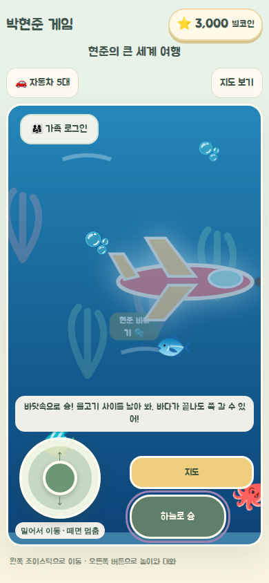
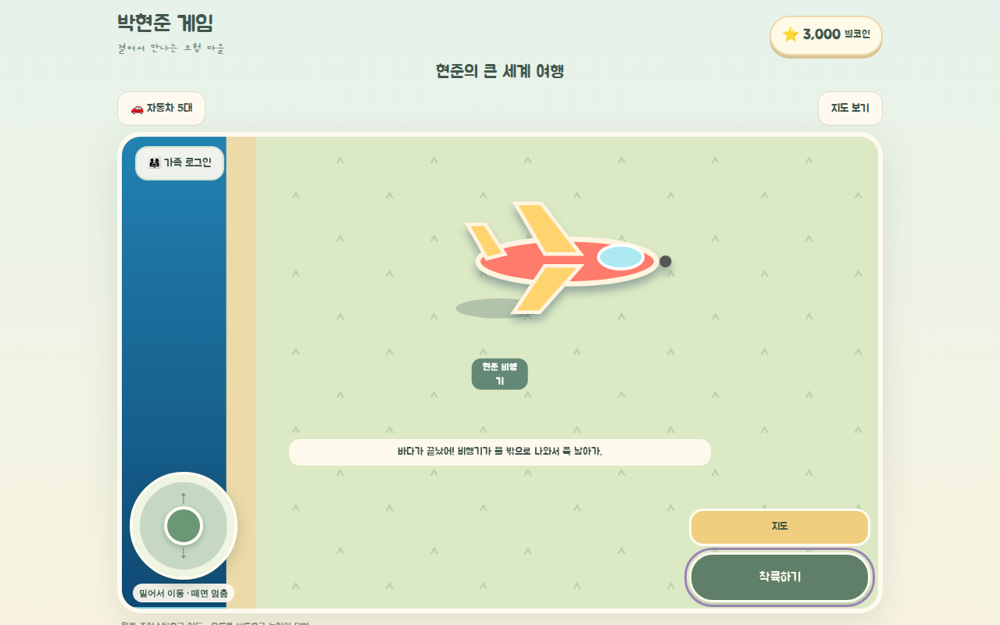
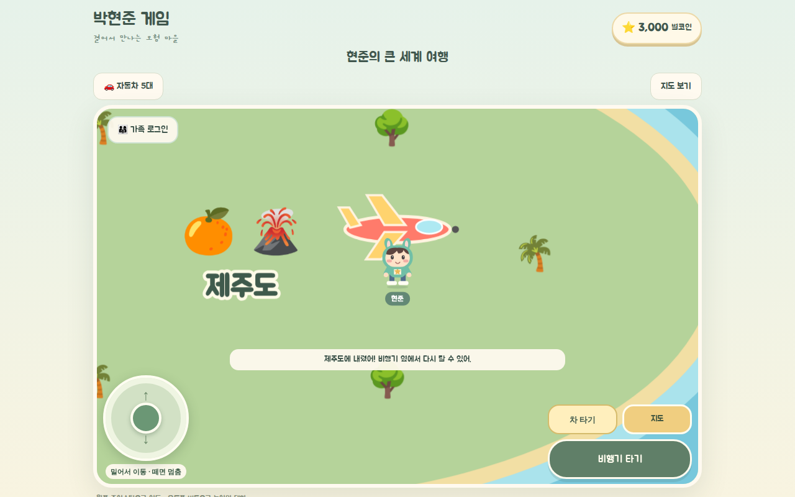
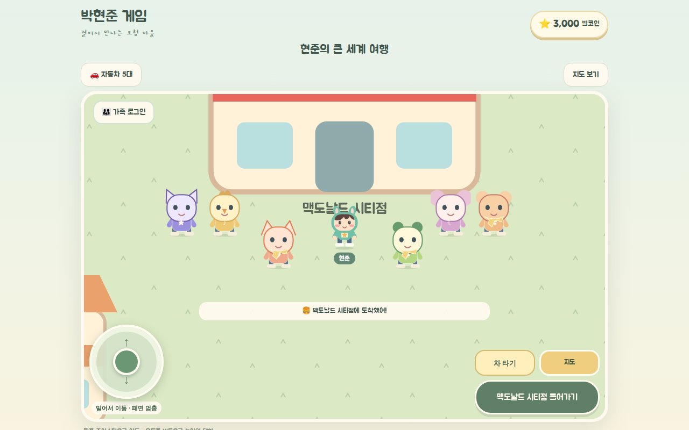
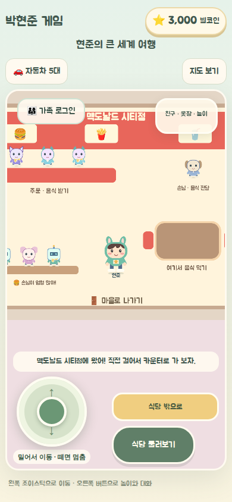
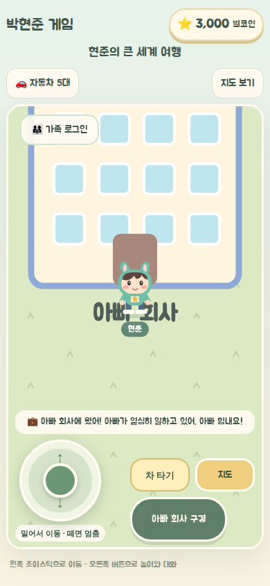
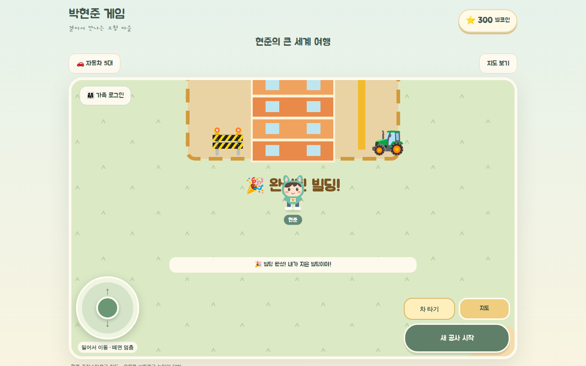
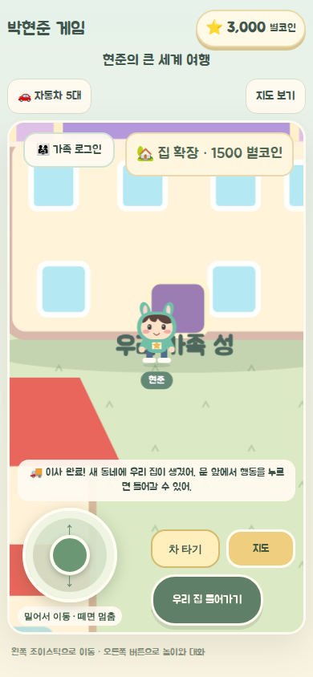
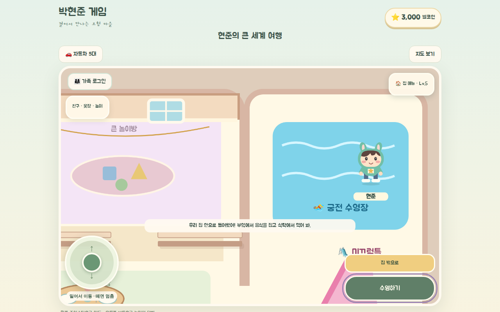
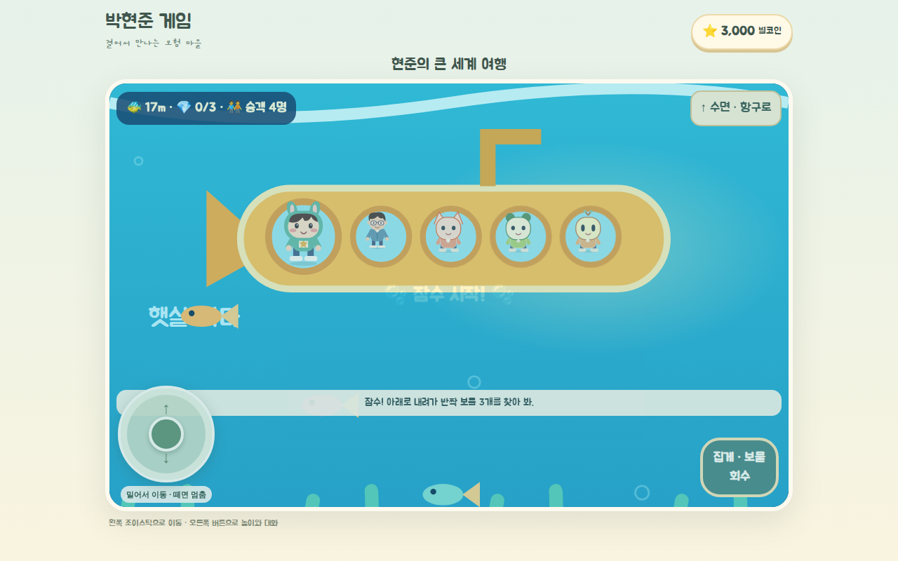

## 후속 수정 — 건물 안에서도 가족이 함께 보이기 (2026-10-25)

가족이 함께 플레이하던 중, 맥도날드 안에 들어가면 아이 캐릭터가 보이지 않는다는 보고가 있었다.

- 원인: 식당·집 안에 들어가면 가족방 위치 전송이 꺼지고(`active: false`), 다른 가족의 캐릭터는 바깥 마을 화면에만 그려졌다.
- 수정: 식당 8곳을 각각 가족방 지역(`restaurant-<id>`)으로 추가했다. 위치는 식당 방 크기 안으로 검증한다. 집 안에서는 `mansion` 지역과 실내 좌표를 보낸다. 같은 실내에 있는 가족은 내 캐릭터와 같은 크기로 이름·이모트와 함께 보인다.
- 프로토콜이 바뀌었으므로 모든 기기가 새 버전으로 접속해야 실내에서 서로 보인다.
- 검증:
  - 같은 기기 미리보기 모드에서 두 창으로 확인했다. 맥도날드 시티점 안에서 서로 1명씩 보이고, 밖으로 나와도 보이고, 집 안에서도 보였다. 브라우저 오류는 없었다.
  - 단위 테스트 122/122 PASS.
  - `verify-living-world.cjs`의 family·restaurants PASS.
  - Supabase 온라인 모드에서 실제 두 기기로 확인하는 것은 NOT RUN.

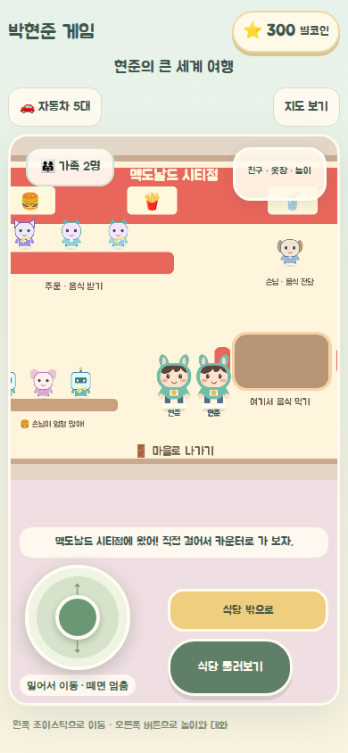

## 후속 수정 — 마을 건물과 이웃집 안으로 들어가기 (2026-10-31)

식당과 집 말고 다른 건물은 겉모습만 있고 안으로 들어갈 수 없었다.

- 별빛 마트·아빠 회사·학교·장난감 가게·병원·도서관 6곳과, 새 동네 이웃집(식당과 겹치는 자리는 빼고) 35곳, 모두 41곳에 실내를 만들었다. 공통 실내 방(`src/game/building-interiors.ts`, `src/components/hyunjun/BuildingScene.tsx`)을 쓴다.
- 문 앞에서 `<건물> 들어가기` → 실내를 걸어 다니기 → 가운데 탁자 앞에서 건물별 행동(장보기, 아빠 응원하기, 책 읽기 등) → 문으로 나가거나 `건물 밖으로` 버튼. 나오면 들어간 문 앞에 선다. 실내에서 지도로 이동하면 실내가 닫힌다.
- 가족방: 건물마다 `building-<id>` 지역을 추가했다. 같은 건물 안에 있는 가족끼리만 서로 보인다. 프로토콜이 또 바뀌었으므로 모든 기기가 새 버전이어야 한다.
- 아빠 회사에는 일하는 아빠가 있다. 아빠가 `같이 가자`로 따라온 경우에는 따라온 아빠만 보이도록 해서 아빠가 두 명 보이지 않게 했다.
- 검증:
  - 단위 테스트 125/125 PASS, `tsc --noEmit` PASS.
  - `scripts/verify-building-interiors.cjs` (headless Chromium, 1280×900·390×844): 태블릿 41개 건물 출입·행동·두 가지 나가기, 식당 8곳, 원래 집, 지도 이동 시 실내 해제 모두 PASS(2026-10-31, 전체 실행). 아빠 중복 수정 후에는 `PHJ_BUILDING_SMOKE=1` 빠른 실행으로 마트·아빠 회사·이웃집과 "따라온 아빠 1명만" 확인 PASS. 브라우저 오류 0건.
  - 실제 두 기기로 같은 건물·다른 건물에 들어가 보는 것, 삼성 브라우저·S Pen 실기기 확인은 NOT RUN.

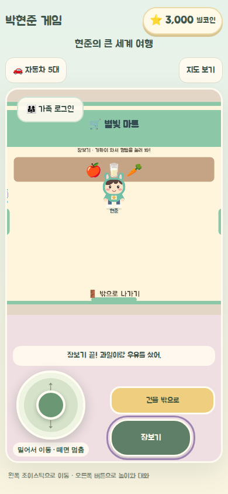
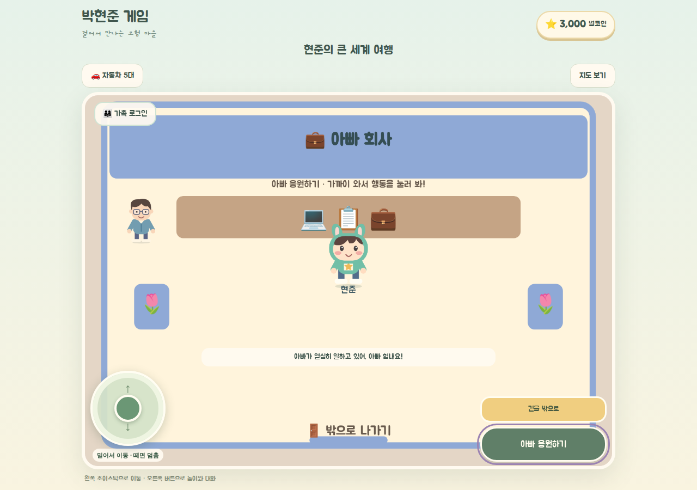
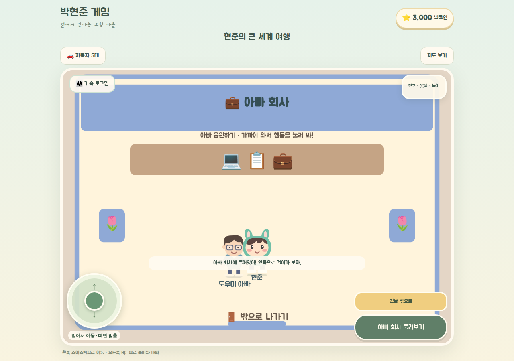
